# blazehttp — design (v6)

> **blazehttp**: a Node.js HTTP client with an axios-style TypeScript API and **our own HTTP engine, written from scratch in Rust**.
> **Owner decisions (2026-11-06):** name `blazehttp`; licence MIT OR Apache-2.0; public repo on the owner's GitHub, owner's npm account + npm org `blazehttp`; built by Claude Code with sub-agents, owner approves every phase gate; missed speed gate → keep optimising, no release on a fallback; one native engine at every load; **HTTP engine written from scratch** (no HTTP engine is reused — never hyper/reqwest/undici as the engine; only infrastructure crates: tokio for sockets, rustls for TLS, compression decoders, `url`/`idna` for redirect URL resolution, small utilities and napi-rs for the binding — §14); **own HTTP/1.1 in 1.0, own HTTP/2 in 1.1**; **headline goal: our engine beats the fastest HTTP client engines in every language (Rust, C, C++, Zig, Go)**; learn from proven open-source code and reuse its test cases; always keep searching for what makes the engine faster.
> Horizon: 1.0 in ~32 weeks (the from-scratch engine phase is split into P1a + P1b after feasibility review), 1.1 (HTTP/2) ~10 weeks later. Author decisions (owner delegated "best decision") are marked **[author's call]**. Review history: §25.

## 1. Context and evidence

Spike: `spike/httpbench/`. JSON ~1 KB, 3 headers, multi-core Go server, client measured alone.

**A. Linux, client capped at 1 CPU (cgroup), Node 26, arm64, c = 50**

| Client | req/s | vs undici | p50 | p99 | CPU per 1k req | Peak RSS |
|---|---|---|---|---|---|---|
| **Rust prototype in Node (reqwest + batched delivery)** | **63,790** | **1.77×** | 0.45 ms | 2.70 ms | 15.1 ms | 92 MB |
| undici 8.12 `Pool.request` + `JSON.parse` | 36,017 | 1.00× | 0.75 ms | 14.76 ms | 27.0 ms | 159 MB |
| axios 1.21 | 8,728 | 0.24× | 4.06 ms | 39.67 ms | 114.4 ms | 185 MB |

**A′. Re-measured on the reference host after raising Docker to 8 CPUs (same method):** prototype 61,027 req/s (**1.87×** undici 32,644), p99 1.49 ms vs 35.33 ms, CPU 16.5 vs 29.5 ms per 1k, peak RSS 91 vs 163 MB; axios 7,688. Absolute numbers moved within noise; the reference-cell gate stays ≥ max(63,790, 61,027) = **63,790 req/s**.

**B. Cross-language, macOS M2, one core, c = 50:** Rust reqwest 87,226 · Node prototype 79,081 · undici 44,015 · Go net/http 31,668 · Java HttpClient 22,488 · Python aiohttp 18,039 · axios 11,213 · Python httpx 1,088. **C/C++/Zig (Bun) and a same-setup Linux re-run: §1-E.**
**C. Low load:** loopback c = 1 ≈ 0.5× undici (+0.06 ms p50); **netem 1 ms RTT, c = 1: +0.65 ms p50** (prototype, 3 thread hops); netem 10 ms: ≈ 0; c = 8: equal or ahead.
**D.** undici + Milo (Rust parser in WASM) 0.97× undici — a faster parser alone does nothing.
**F. Pure Rust, Linux Docker, client 1 CPU, 1 KB JSON + `serde_json`, c = 50 (round-6 measurement, `spike/g0`):** hyper `client::conn` 5.3–5.7 µs CPU per request (152–174k req/s) · a 40-line tokio + httparse loop with no features 4.0–5.5 µs · reqwest 8.5–10.4 µs · ureq 11.8–15 µs. These are quiet-run values; noisy runs (`spike/g0/res.txt`: hyper 6.0–13.4 µs, raw loop 4.7–8.9 µs) show why gate runs need an idle host. At c = 1: minimal loop 19.8–20.8k req/s vs hyper 18.3–19.5k. **The honest room to beat hyper is ≈ 5–25%**, and every feature we add must fit inside it. The 2-CPU Go test server saturates at ≈ 225k req/s, so G0 needs a faster server (§16.2).
**E. Cross-language, Linux Docker arm64, client 1 CPU, 1 KB JSON, c = 50, median of 3 (`spike/httpbench/xlang/`):** C++ Boost.Beast 127,776 · Zig `std.http.Client` 114,789 (50 OS threads, blocking) · Bun `fetch` 113,884 · C libcurl multi 111,949 (JSON checked by a minimal scanner, not fully parsed) · Rust reqwest 98,298 · **blazehttp prototype on Node 62,923** · undici 35,989 · Deno `fetch` 33,344 · Go `net/http` 29,392. Noise ±15–30% between rounds, so the top five are statistically close. Bun is fast because its HTTP client is built into the runtime (no JS↔native boundary) — the reason the cross-runtime comparison is advisory (G1-JS) rather than a gate.

Findings: (1) axios's cost is its JS layers; (2) moving the whole network path to a native thread with batched delivery wins under load; (3) the handoff costs a fixed amount per request at low load, small on real networks but measurable at 1 ms RTT — a P0 risk (§18); (4) reqwest/hyper carry generality (header maps, middleware, allocations) that a purpose-built engine can avoid.

## 2. Goals

| # | Goal | Measure (statistics §16.4) |
|---|------|---|
| **G0 — headline** | **Our engine beats the fastest HTTP client engines in every language** (owner goal) | Native engine benchmark (no JS): `blazehttp-engine` vs **Rust** hyper (`client::conn`), reqwest, ureq, isahc · **C** libcurl (multi), libh2o client (pinned commit SHA — the project publishes no releases) · **C++** Boost.Beast, cpp-httplib · **Zig** `std.http.Client` · **Go** `net/http`, fasthttp · **Java** Netty (its HTTP client codec), Jetty `HttpClient`, `java.net.http.HttpClient` · **.NET** `HttpClient` (`SocketsHttpHandler`) (Java and .NET added by owner decision 2026-11-08) — identical work: **cross-language cells do no JSON parsing** — every client computes the same FNV-1a checksum over the body bytes (`serde_json` only in the Rust-only cells, §1-F style); Bun is not a G0 competitor (it runs JavaScript — G1-JS advisory row); blocking clients (ureq, cpp-httplib, Zig `std.http.Client`) run thread-per-request with threads = c and are labelled; per-language release settings (C/C++ `-O3` with the same baseline target, Zig `ReleaseFast`, Go default, Rust release profile, Java on the latest LTS JDK and .NET on the latest LTS SDK in Release, both warmed up to steady state before measuring), rustls/`ring` for Rust competitors where configurable and each language's standard TLS for the others (reported), 1 CPU. Kernel-bypass stacks (DPDK, AF_XDP) are a different class and reported separately if measured. **Engine-bound cells** (plaintext 1 KB at c = 50 and 500, 20 headers, chunked): **fastest** — CI lower bound ≥ 1.0× the best competitor (stretch: 1.15×); primary metric **CPU µs per request at a fixed offered load**, plus maximum throughput. **Shared-limit cells** (HTTPS where crypto dominates, 1 MB bodies where copying dominates, c = 1 where the round trip dominates): **#1 as well** — median faster than every competitor over 10 rounds, with CI lower bound ≥ 0.97× as the noise allowance (owner decision 2026-11-08: #1 in every cell). Lowest CPU per request in engine-bound cells. **Zero engine heap allocations per request in steady state on plaintext HTTP/1.1** (per-thread counter around the engine only — the caller's JSON parsing, which allocates in every client, is excluded); for HTTPS, rustls's `unbuffered` API with pooled buffers is pursued as a stretch target. The ≤ 1.10× raw-loop budget (§16.2) is only a ceiling — beating hyper in the same run is the binding constraint |
| G1 | Full Node client is fast | Reference cell (1 KB JSON, c = 50, plaintext, 1 CPU): **≥ 63,790 req/s**; core-cell geometric mean ≥ 1.4× raw undici (CI lower bound ≥ 1.3×); extra cells #1 by median against undici and every G1-JS client, CI lower bound ≥ 0.95× as the noise allowance |
| G1-JS | #1 for JavaScript | **Gate:** fastest per core on Node vs undici, Node `fetch`, axios, `ky`/`ofetch` on the core cells. **Leaderboard target (advisory):** blazehttp on Node vs Bun `fetch` on Bun and Deno `fetch` on Deno; running the native addon inside Bun is best-effort, not gated |
| G1-low | Small cost at low load | c = 1, 2, 4, 8 with netem 1 ms and 10 ms RTT: p50 and p99 no higher than undici's (median delta ≤ 0 over 10 rounds; the CI upper bound of the delta stays ≤ +0.1 ms p50 / +0.3 ms p99 as the noise allowance) (at risk at 1 ms — §18) |
| G2 | Light on the server (CPU and RAM) | Core cells: ≤ 0.8× undici CPU per 1k; **the lowest peak RSS of every Node client measured (median) and ≤ 0.7× undici** (prototype 91–92 MB vs undici 159–163 MB, §1-A/A′); main thread ≤ 75% busy at undici's saturation load; **runs the core cells at c = 50 and c = 500 plus an open-loop burst cell inside a 128 MiB-memory container** without OOM (requests beyond the auto-sized limits fail fast with typed errors, never hang); RSS returns to within 10% of baseline 60 s after a burst, on every allocator target |
| G3 | Familiar API | axios-style; §3.1 fully supported; the rest in the migration guide |
| G4 | Every library failure is a typed `HttpError` | §8; user-code errors re-thrown unchanged |
| G5 | Works everywhere, same behaviour | Native engine on 8 targets (macOS arm64/x64, Linux x64/arm64 × glibc/musl, Windows x64/arm64); Node ≥ 22.19; undici transport (fallback / explicit) behaves identically; browser/Deno/edge on `fetch` (+ XHR) with documented limits |
| G6 | Bounded, nothing stalls | Every queue, buffer, cache and window bounded and charged; no global pause; no per-request JS timers; every request settles; RSS flat over 10M requests |
| G7 | Code quality | TS strict + no `any`; Rust `clippy::pedantic` deny, `#![forbid(unsafe_code)]` in `engine-core`; `unsafe` only in `engine-simd` (SIMD intrinsics + runtime detection on x86; NEON is baseline on arm64) and `node-binding`, every block with `// SAFETY:`, Miri and fuzzing; coverage ≥ 95% TS / ≥ 90% Rust; review gate per phase |
| G8 | Leaderboard | Open, reproducible cross-language benchmark in the repo, re-run every release, honest results published |

**Non-goals (1.0):** HTTP server; replacing global `fetch`; cookie jar; HTTP/2 (→ 1.1); HTTP/3; TLS 1.0/1.1; own TLS or crypto; revocation checking.
**Anti-goals:** slower than the fastest HTTP client engine in any language (G0) or undici under load · any low-load latency penalty against undici · panics crashing the process · behaviour drift between Node transports · a request that never settles · secrets in errors/logs · `postinstall` · a pattern without a responsibility · a workaround where a root fix exists · copying code we do not understand.

## 3. Public API

```ts
import blaze, { createClient, isHttpError } from 'blazehttp';

const { data } = await blaze.get<User[]>('https://api.example.com/users', { params: { page: 2 } });

const api = createClient({
  baseURL: 'https://api.example.com',
  headers: { 'x-app': 'billing' },
  timeout: 10_000,                           // number = total (0 = none); or { total, connect, headers, idleBody, idleSend, queue, stall }
  retry: { attempts: 2 },                    // off by default (axios parity) [author's call]
  auth: { username: 'u', password: 'p' },
  tls: { ca: [pem], cert, key, servername }, // client-level only
  proxy: { url: 'http://proxy:3128' },       // client-level only; env proxies honoured by default (axios parity)
  blockPrivateNetworks: true,                // client-level only; default false (axios parity)
  transport: 'auto',                         // 'auto' | 'native' | 'undici' — client-level only
});

api.interceptors.request.use((config) => { config.headers.authorization = `Bearer ${token()}`; return config; });
const user = await api.post<User>('/users', { name: 'A' });
await api.postForm('/upload', { file: blob, note: 'x' });
const res = await api.get('/export', { responseType: 'stream' });
res.headers['content-type'];
await api.close();
```

### 3.1 Option list for 1.0
**Supported:** `url`, `method`, `baseURL`, `allowAbsoluteUrls`, `params`, `paramsSerializer`, `headers`, `data`, `auth`, `timeout`, `signal`, `responseType` (`json`, `text`, `arraybuffer`, `blob`, `stream`), `responseEncoding`, `validateStatus`, `transformRequest`, `transformResponse`, `maxContentLength`, `maxBodyLength`, `maxRedirects`, `maxRate`, `decompress`, `proxy`, `tls`, `transport`, `onUploadProgress`, `onDownloadProgress`, `xsrfCookieName`, `xsrfHeaderName`, `withCredentials`, `retry`, `blockPrivateNetworks`, `ssrf` (`allowLocalNat64`); verbs, `postForm/putForm/patchForm`, `request`, `create`/`createClient`, `interceptors`, `isHttpError` (+ `isAxiosError`), `close`.
**JSON parity (verified against axios 1.21 `lib/defaults/index.js` + `transitional.js`):** axios defaults to `transitional.silentJSONParsing: true`, so invalid JSON returns the raw string whether `responseType` is unset or `'json'`; blazehttp matches this by default. `transitional: { silentJSONParsing: false }` (supported, same name as axios) makes invalid JSON with `responseType: 'json'` fail with `PARSE/json`.
**Unsupported in 1.0 (documented):** `CancelToken`, `httpAgent`/`httpsAgent`, `lookup`, `family`, `socketPath`, `beforeRedirect`, `fetchOptions`, `responseType: 'document'`, `adapter`; `http2` arrives in 1.1.

### 3.2 Semantics
- Precedence: library defaults → instance defaults (normalised and validated once in `createClient`) → per-request deltas.
- **Interceptors (axios parity), owned by `Client`:** request interceptors (last registered first) → `transformRequest` → `classifyBody(transformedData, headers)` → transport pipeline → `validateStatus` → `transformResponse` → response interceptors. Request-interceptor throws and transport errors flow through response rejection handlers. `Client` tracks every request from entry, so `close()` also covers requests still inside async interceptors.
- **Client-level only:** `tls`, `proxy` (incl. `proxy.tls`), `blockPrivateNetworks`, `ssrf`, `transport`, engine options.
- **`allowAbsoluteUrls`** (default `false` with `baseURL`): resolve, compare origins; mismatch → `INVALID_CONFIG`.
- **Default timeouts** [author's call]: `connect` 10 s (DNS + TCP + proxy + TLS), `headers` 300 s (runs from request start to the final response head; interim 1xx heads never extend it **[author's call]**), `idleBody` 300 s, **`idleSend` 300 s** (request body not accepted by the server), `queue` 60 s, **`stall` 60 s** (a `stream` response the consumer has not read from for 60 s while the engine holds data for it → `TIMEOUT/stall`), minimum body rate 512 B/s over 60 s for non-stream responses (`TIMEOUT/slow-body`, suspended during engine-initiated pauses); `total` unset on Node; browser `total` 300 s (until headers for `stream`) — implemented with `AbortSignal.timeout`, i.e. one platform timer per request: a documented **browser-only exception** to G6's "no per-request JS timers" (browsers offer no other way to bound a `fetch`); `timeout: 0` disables `total`.
- **XSRF:** same-origin only.

## 4. Architecture

```mermaid
flowchart TD
    subgraph TS["packages/blazehttp (main thread / worker / browser / edge)"]
      Client["Client — Facade<br/>InterceptorChain, in-flight tracking, start/end/error events<br/>store: frozen defaults"]
      Prep["RequestPreparer<br/>store: none"]
      Final["ResponseFinalizer<br/>validateStatus, transformResponse, createHttpError<br/>store: none"]
      Lazy["LazyTransport — virtual Proxy<br/>store: transport ref"]
      Retry["RetryTransport — Decorator<br/>store: retry budget"]
      Mat["BodyMaterializer — Decorator<br/>skips bodies of statuses that will be retried<br/>store: none"]
      Obs["ObservedTransport — Decorator<br/>attempt/headers events at real header time<br/>store: none"]
      NT["NativeTransport — Adapter (per client)<br/>store: key set, profile lease"]
      UT["UndiciTransport — Adapter on dispatch()<br/>DispatchHooks: onRequest in spec order (redirect, limits, decompress, rate);<br/>onHeaders/onChunk/onComplete in reverse order after the header re-check<br/>(timeouts come from the TimerHeap service)<br/>store: agents in AgentRegistry"]
      FT["FetchTransport / XhrTransport<br/>store: none"]
      Sess["NativeSession — per-environment Singleton<br/>SubmissionBatchBuilder, SlotTable, CompletionRouter, WireDecoder<br/>store: arenas, slot slab"]
      Wheel["TimerHeap — per-environment Singleton (via Clock)<br/>store: indexed min-heap + 1 timer"]
    end
    subgraph Bind["crates/node-binding (napi-rs)"]
      Codec["Batch codec → EngineCommand<br/>store: none"]
      Sink["CompletionSink — two capacity-reusing completion Vecs swapped per take<br/>+ one return Vec per (environment, shard thread) for buffer handles<br/>store: bounded by pending requests"]
      Wake["ThreadsafeFunction per env<br/>store: none"]
    end
    subgraph Core["crates/engine-core (pure Rust, no napi, forbid(unsafe))"]
      Root["Engine root — OnceLock Singleton (immutable)<br/>dispatcher sender + shard-thread senders<br/>store: nothing mutable"]
      Disp["Dispatcher — control plane only, on its own control thread (current_thread runtime)<br/>profile registry, header templates, config, close/teardown fan-out,<br/>control replies (after shard-side effects are enqueued)<br/>store: control state (owned, no lock)"]
      PC["Shard = a ProfileContext's data plane, hosted on a shard thread<br/>(dedicated thread: current_thread runtime + LocalSet)<br/>task slab, scheduler, pool, timer heap, DNS LRU + single-flight, budget share, TLS session cache<br/>store: thread-local Rc&lt;RefCell&gt; (no lock); global budget via atomics"]
      Simd["engine-simd — audited unsafe SIMD scanning<br/>store: none"]
      Tasks["Task slab inside the shard (RequestKey → request entry)<br/>store: slab"]
      Mw["Exchange middleware — Decorators (order from spec.json)<br/>Redirect → Limits → Decompress → Rate<br/>store: per-request"]
      Sched["Scheduler per (profile, origin)<br/>per-client round-robin fairness, intrusive lists<br/>store: bounded"]
      H1["h1 Connection — WriteHalf + ReadHalf state machines<br/>RequestWriter, ResponseParser (engine-simd), FramingDecoder strategies<br/>store: pooled buffers"]
      Pool["Connection pool (own)<br/>store: idle conns, buffer pools"]
      Conn["Connector: DNS (single-flight, shares, negative cache) → SSRF → proxy CONNECT/SOCKS → rustls<br/>store: DNS LRU, TLS session cache"]
    end
    API[("Remote API")]

    Client -->|sync| Prep --> Lazy --> Retry --> Mat --> Obs
    Obs --> NT
    Obs --> UT
    Obs --> FT
    Client --> Final
    NT --> Sess
    Sess -->|"sync: 1 submit() per flush (data commands)"| Codec
    Sess -->|"sync: control() (control commands)"| Codec
    Codec -->|"data commands: straight to the shard thread's queue"| PC
    Codec -->|"control commands"| Disp
    Disp -.->|"async: open/close/teardown fan-out"| PC
    Root -.->|"async: Poison (per shard-thread command) sent directly to every shard thread"| PC
    Disp -.->|"async: control-reply records"| Sink
    PC --> Tasks --> Mw --> Sched --> Pool --> Conn --> H1 --> API
    H1 --- Simd
    H1 -.->|"async: CompletionSink::push (trait defined in engine-core, implemented in node-binding)"| Sink
    Sink -.->|"async: fire once on empty→non-empty"| Wake
    Wake -.->|"async wake"| Sess
    Sess -->|"sync: takeCompleted() over one snapshot"| Sink
    Root --- Disp
```



**Crates:** `engine-core` (the HTTP engine: protocol, pool, connector; `forbid(unsafe)`; exports `EngineCommand`, the `Execute` trait and `trait CompletionSink` — it depends on nothing Node-specific), `engine-simd` (the only engine crate with `unsafe`: `std::arch` SIMD scanning with runtime CPU detection, every block with `// SAFETY:`, checked by Miri and fuzzing, scalar fallback; exposes a safe API), `node-binding` (napi bridge: implements `CompletionSink` with the TSFN and owns the batch codec), `engine-bench` (G0 harness: implements `CompletionSink` with a channel, so G0 measures the same engine code path Node uses). **Composition:** kits return base transports; the `TransportComposer` — the creator whose `compose(kit)` calls `kit.createTransport()` — wraps the result as `Retry → BodyMaterializer → Observed → base`; `LazyTransport` wraps the composed transport. **Terms:** a **shard** is one `ProfileContext`'s data plane; a **shard thread** is a dedicated OS thread (tokio `current_thread` runtime + `LocalSet`) that hosts one or more shards.

### Request flow (native)
1. `Client` tracks the request, runs request interceptors; `RequestPreparer` → `PreparedRequest` (value object).
2. `LazyTransport` → `Retry` → `BodyMaterializer` → `Observed` → `NativeTransport` (per client: profile lease, header-template ref, own key set).
3. `NativeSession` allocates a key and appends to the batch arena. **Flush always via one `setImmediate`** (batches requests made across macrotasks, e.g. a server calling upstream APIs per inbound request); batch cap 4,096 records or a full arena; bodies > 1 MiB never ride the batch.
4. `submit()` (sync): borrowed slices; per-request bytes copied into **pooled** buffers on the main thread (returned to the pool that owns them, so memory is never allocated on one thread and freed on another per request); data commands (`Submit`, `Credit`, `Cancel`, `UploadChunk`) go **straight to each shard thread's queue** — the profile lease carries the shard thread's sender and every `RequestKey` encodes its shard id — so the dispatcher is never on the data path; request buffers return to their pool in the next submit batch. Control commands (open/close profile, templates, client close, teardown) use a separate sync napi call, `control()`; the `SubmissionBatchBuilder` carries data commands only. **Control-call contract:** `control()` returns a request id at once; the dispatcher answers asynchronously with a **control-reply record** through the same completion path (TSFN + `takeCompleted()`). **Ordering rule:** the dispatcher replies only after the shard-side effects (profile opened on its shard thread, template registered there) have been **enqueued on that shard thread's FIFO queue**, so any later direct `Submit` on the same queue is guaranteed to see them. `NativeTransport` holds its first submits until the lease reply (shard id, sender, generation) arrives — one await per client lifetime, then cached — and likewise waits for each `RegisterTemplate` reply before using the template.
5. Engine (inside the shard thread): profile (generation-checked) → task slab → middleware → scheduler (per-hop permit, per-client fairness) → pool checkout → connector (new connections only) → h1 connection.
6. Completion: the connection task **hands its read buffer** (head + small body, chunked bodies de-framed in place) over to the completion record and takes a fresh pooled buffer for the connection — unless the response fills less than ¼ of the buffer, in which case it is copied out and the buffer kept; the budget charge for a handed-off buffer is **released at handoff to JS** (the bytes then belong to the JS response, which V8 accounts for), and the buffer itself is reclaimed through the return `Vec` on the next push or on idle; then it pushes a small fixed-size record into the environment's active completion `Vec` (lock held only for the push — no code that can panic runs under this lock; capacity reused, so pushes do not allocate in steady state). A connection that finishes takes the next queued request for its origin itself. TSFN fires once on empty→non-empty.
7. Wake: `takeCompleted()` swaps the active `Vec` with the spare one under the mutex — only after the spare was fully drained (no `unsafe`, no shared linked list) — then copies outside the lock into JS arenas (repeat calls while `more`). Consumed buffer handles go into a **return `Vec` per (environment, shard thread)**, swapped under the same completion mutex; each shard thread reclaims its own handles on its next push, so buffers always return to the pool that owns them without extra locks or messages. Both Vecs and the slot slab shrink after 30 s idle, so a burst does not keep its peak memory forever.
8. `CompletionRouter` handles each record in isolation; headers → one exact-size latin1 string; it only **fills** the attempt's `BodySource` (no decoding); stale generations dropped. `BodyMaterializer` is the **only** caller of `BodySource.consume(decoder)` / `stream()` — it skips bodies of statuses that will be retried and otherwise decodes once with the request's single `ResponseDecoder`. `ResponseFinalizer` → response interceptors → settle.

## 5. Our HTTP/1.1 engine (from scratch)

### 5.1 Components
| Component | Responsibility | Key rules |
|---|---|---|
| `ResponseParser` | Parse status line + headers into **offsets** (no header map, no per-header allocation) | Byte scanning from `engine-simd` (SSE4.2/AVX2 on x64, NEON on arm64, runtime-detected, scalar fallback) |
| `RequestWriter` | Serialise method, target, headers into a pooled buffer; vectored write with the body | Pre-encoded template bytes for default headers; one syscall per request where possible |
| `FramingDecoder` (Strategy) | `ContentLength`, `Chunked`, `CloseDelimited`, `Empty` | §5.2 rules; trailers bounded and dropped (never merged) |
| `Connection` (State) | Two state machines: **`WriteHalf`** `Head → Body → Done` and **`ReadHalf`** `Head → Body(FramingDecoder) → Done`; credit exhaustion is a `paused` flag, not a state | Reading and writing overlap (early responses); the connection is reusable only when **both halves end cleanly** |
| `Pool` + `Scheduler` | Idle connections per origin, caps, FIFO with per-client round-robin; honours the server's `Keep-Alive: timeout` | O(1) checkout and cancel (intrusive lists); requests are slab entries driven by connection tasks — **no task spawned per request**; a finished connection takes the next queued request itself (≤ 1 task wake per request + 1 per batch in steady state, excluding I/O readiness — asserted in G0) |
| `Connector` | DNS, SSRF, proxy, TLS | §12 |
| Middleware (`Exchange` trait, Decorator) | Redirect → Limits → Decompress → Rate (one order, defined in `spec.json`, used by both Node transports) | Limits sees decompressed bytes; statically composed generics (no `dyn`, no boxing); no `tower` dependency; each layer one file, one responsibility |

**Connection reuse rules (no pipelining):** one exchange per connection at a time; requests are never pipelined. A connection is **closed, never pooled**, when: bytes remain in the read buffer after the response ends; any byte arrives while it is idle (how idle connections are watched is specified in the P0 connection research note, `docs/notes/`, Task 6 **[author's call]**); a final response arrives before the request body is fully written (stop writing, deliver the response, close); any parse, timeout, abort or TLS error occurs; or the response is close-delimited. A connection is also closed after `Connection: close` (either side) and after an HTTP/1.0 response without an explicit keep-alive. **Stale-connection rule** (inspired by Go `net/http`, which re-sends only `GET`/`HEAD`/`OPTIONS`/`TRACE`; our method set below is **our own choice** [author's call]): a request sent on a *reused* connection is re-sent once on a fresh connection only when **all** of these hold: the connection ended with EOF, a reset or a write error **before any response byte (interim heads included)** arrived **[author's call]** (never after a timeout or an abort); the request is still unsettled; the method is idempotent (`GET`, `HEAD`, `OPTIONS`, `PUT`, `DELETE`, `QUERY`; QUERY is safe and idempotent and may carry a body); and the body is empty or held entirely in the engine (≤ 1 MiB, not credit-streamed). Otherwise the only re-send is for requests of which zero bytes were written. The re-send is transparent, reported in `timings`, separate from the user-facing retry feature, and covered by the conformance suite on both transports. `Expect: 100-continue` is never sent in 1.0 (parity with undici/axios); unsolicited 1xx responses are skipped within limits.

### 5.2 Protocol safety (request smuggling / response splitting)
The client parser is strict; every rule has test vectors from the reference corpora (§6) and a fuzz target.
- **Status line:** exactly `HTTP/1.0` or `HTTP/1.1`, one SP, 3 digits in 100–599, then either CRLF (empty reason) or SP and a reason phrase without control characters except HTAB; HTTP/0.9 and `101` (no upgrades requested) rejected; ≤ 8 KiB including CRLF **[author's call]**.
- **Line endings:** CRLF only; a bare LF or bare CR anywhere in the head is rejected.
- **Header fields:** token names (RFC 9110); no whitespace before the colon; any field line starting with SP or HTAB rejected (obs-fold, or a hidden first field) **[author's call]**; values without control characters except HTAB; ≤ 100 fields **per head** and ≤ 64 KiB of head bytes **cumulative, including all 1xx heads**; the 64 KiB head and 8 KiB status-line limits count every byte including CRLF **[author's call]**; ≤ 10 interim (1xx) responses.
- **`Content-Length`:** `1*DIGIT` only after OWS trimming (RFC 9110 §5.5) — no sign, internal whitespace, lists or duplicates (even equal ones); must fit in `u64`.
- **Interim (1xx) heads** **[author's call]**: the `Content-Length`/`Transfer-Encoding` grammar and conflict rules apply to every head, 1xx included; a 1xx head carrying `Transfer-Encoding` or a `Content-Length` other than `0` → `PROTOCOL/smuggling-risk`; `Connection: close` in a 1xx head makes the connection non-reusable after the exchange.
- **`Transfer-Encoding`:** only the value `chunked`, compared ASCII case-insensitively after OWS (SP, HTAB) trimming **[author's call]** (no other codings are implemented); with `Content-Length` present, or on an HTTP/1.0 response → rejected.
- **Chunked:** chunk size `1*HEXDIG` (≤ 16 digits including leading zeros; no `0x`, no sign, no whitespace except optional BWS before `;`); every chunk-size line, chunk extension and trailer line ends in CRLF only — a bare CR or LF anywhere in them is rejected **[author's call]**; chunk extensions bounded (≤ 4 KiB per message), validated as RFC 9112 §7.1.1 `chunk-ext` (no control characters except HTAB) and then ignored **[author's call]**; exactly CRLF after each chunk's data, nothing else; trailers bounded (≤ 16 KiB, ≤ 100 fields) and discarded.
- **Bodies:** none for `HEAD`, 1xx, 204, 304 regardless of headers (a 1xx carrying framing headers is rejected, see Interim heads); a 204 or 304 response carrying `Transfer-Encoding` or a `Content-Length` other than 0 is accepted without a body and its connection is not reused (`HEAD` excluded) **[author's call]** — RFC 9110 §8.6 permits `Content-Length` on a 304, but we keep the no-reuse rule for undici parity and as a client-side-desync defence until the Task 6 idle-byte detection exists, and revisit it with Task 6 data (`docs/notes/response-parser.md` §6.5); a close-delimited body over TLS that ends without `close_notify` → `PROTOCOL/truncated`.
- **EOF before the final head** **[author's call]**: `NETWORK/closed-before-response` only when zero bytes of this exchange's response were received (interim heads included); otherwise `PROTOCOL/malformed-response`.
- **Repeated fields:** more than one `Transfer-Encoding` field → rejected; DEL (0x7F) treated as a control character everywhere.
- **Outgoing request target:** validated after `paramsSerializer` runs — no SP, control characters or non-ASCII (percent-encoded by the URL layer or rejected).
- **Errors never echo raw header bytes** (only offsets and rule names).
- Size limits (head > 64 KiB, status line > 8 KiB) map to `TOO_LARGE/headers`; count and grammar violations (> 100 fields, > 10 interim responses, bad syntax) map to `PROTOCOL/malformed-response`.
- **Scope** **[author's call]**: `ResponseParser` is not used for proxy CONNECT replies (those use the shared bounded CONNECT parser, §9.2).

### 5.3 Speed techniques (baseline; extended by the speed programme §7)
**Where we beat hyper (measured gap §1-F):** the exchange runs **inside the connection task** (hyper hands each request from `SendRequest` to its connection task — one hop we remove) · headers as offsets, no `HeaderMap` · fewer allocations than hyper (≈ 34 per request in the §1-F harness, of which ≈ 25 come from `serde_json`, so hyper's own share is ≈ 9 — our target is 0) · no wasted read attempts after a complete response · requests are slab entries, timers are timer-heap entries (no `Box::pin(Sleep)`, no task per request) · middleware composed statically with generics (no `dyn`, no boxing). **Further techniques:** SIMD scanning (worth ≈ 1–2% at few headers, more at 20+) · pooled read/write buffers · small requests copied head + body into one buffer (one write), vectored writes only for large bodies on plaintext (no gain under TLS) · the read buffer is handed over to the completion record at completion (no copy) and the connection takes a fresh pooled buffer · read batching (large reads, few syscalls) · `TCP_NODELAY` · pre-encoded default-header templates · zero-copy body slices · batched JS↔native delivery · LTO + `codegen-units = 1` · **profile-guided optimisation (PGO)** builds from the benchmark workload · `mimalloc` on musl built with its `local_dynamic_tls` feature (required for a `dlopen`-ed addon on musl; Alpine load test in CI), evaluated elsewhere · steady-state **zero allocations per request on plaintext HTTP/1.1**, asserted by a per-thread counting-allocator test (TLS records are copied and allocated by rustls's buffered API — no zero-copy over TLS).

## 6. Learning from proven code

### 6.1 Process (per component)
1. **Study** 2–3 reference implementations (table below): how they solve it, what bugs they hit (their issue trackers and changelogs), how they test it.
2. **Write a design note** `docs/notes/<component>.md`: what we take, what we do differently and why, links to the exact files/issues studied.
3. **Port their test cases as data vectors** (`tests/vectors/<area>/*.json`, each tagged with its source and licence) — run by `cargo test` (engine), Vitest (TS layer) and the conformance suite (native and undici).
4. **Implement our own** code — no verbatim copying; re-implementation from understanding.
5. **Benchmark against the references** (G0 harness) and record the result.

Licences: all references below are MIT, Apache-2.0, BSD or curl-licence (MIT-style), except HTTP Garden (GPL-3.0), which is studied for bug classes only — none of its files or payloads are copied, and vectors for its classes are written as our own **[author's call]**. Adapted tests keep their copyright notice in the vector file and in `THIRD_PARTY_NOTICES`; no third-party code ships in the npm packages.

### 6.2 Reference matrix
| Area | Study | Test cases to port |
|---|---|---|
| HTTP/1.1 parser | picohttpparser (C, SIMD), httparse (Rust, SIMD), llhttp (Node's parser), hyper `proto/h1`, h11 (Python), Go `net/http`, Bun's HTTP client (Rust since bun-v1.4; heads parsed by picohttpparser) **[author's call]** | llhttp test suite, httparse tests, hyper h1 tests, h11 tests, Go `transfer_test.go`/`response_test.go`, curl tests, HTTP Garden, T-Reqs/HDiff differential cases, PortSwigger (incl. Kettle's client-side desync research), RFC 9112 examples, regression cases from past advisories (hyper RUSTSEC-2021-0078/0079; llhttp CVE-2022-32213/32214/32215, CVE-2023-30589, CVE-2024-27982) |
| Connection pool, keep-alive, timeouts | Go `net/http` Transport, undici `Client`/`Pool`, curl connection cache, hyper-util pool | undici pool/keep-alive/timeout tests, Go transport tests (behaviour) |
| Redirects | undici redirect handler, Go `net/http`, curl, reqwest policy, WHATWG fetch spec | undici + axios redirect tests, WPT fetch redirect cases |
| Decompression | undici decompress, reqwest decoders, curl | bomb/ratio cases, multi-encoding cases |
| Proxy, CONNECT, SOCKS, `NO_PROXY` | Go `http.ProxyFromEnvironment`, `proxy-from-env`, undici `ProxyAgent`, curl | `NO_PROXY` matching vectors (shared Rust/TS), CONNECT/407 cases |
| TLS configuration | rustls examples, Node `tls` docs and tests | legacy-cipher, SHA-1, weak-key, hostname cases |
| SSRF | OWASP SSRF cheat sheet, `ssrf-req-filter`, known rebinding write-ups | address-class vectors (IPv4/IPv6/embedded) |
| API behaviour | axios (interceptors, config merge, transforms, errors), ky/ofetch hooks, got | axios unit tests re-expressed against blazehttp (migration proof) |
| Retry and backoff | got retry, undici `RetryHandler`, AWS "exponential backoff and jitter", gRPC backoff spec | retry-decision vectors |
| Benchmark method | TechEmpower methodology, undici and Bun benchmarks | — |
| HTTP/2 (1.1) | `h2` crate, nghttp2, Go `x/net/http2` | h2spec |

### 6.3 Authoritative references (owner rule: Rust knowledge from the official Rust project)
Every Rust decision, design note and review cites the official Rust project documentation first; blog posts and memory are never the source of truth.
- **Language and std:** *The Rust Programming Language* (doc.rust-lang.org/book), *The Rust Reference* (doc.rust-lang.org/reference), standard library docs (doc.rust-lang.org/std) — incl. `std::arch` and `is_x86_feature_detected!` / `is_aarch64_feature_detected!` for SIMD.
- **Unsafe code:** *The Rustonomicon* (doc.rust-lang.org/nomicon) and the Unsafe Code Guidelines (rust-lang.github.io/unsafe-code-guidelines); Miri (github.com/rust-lang/miri) for checking unsafe code.
- **Tooling:** *The Cargo Book* (doc.rust-lang.org/cargo), *The rustc book* (doc.rust-lang.org/rustc — lints, codegen options, **profile-guided optimisation** chapter), Clippy lint list (rust-lang.github.io/rust-clippy), *The Edition Guide* (doc.rust-lang.org/edition-guide), rustup.
- **API and async design:** Rust API Guidelines (rust-lang.github.io/api-guidelines), *Asynchronous Programming in Rust* (rust-lang.github.io/async-book).
- **Security:** Rust security policy (rust-lang.org/policies/security) and the RustSec advisory database (used by `cargo-deny`/`cargo-audit`).
- **Dependencies:** each crate's own docs on docs.rs and its project site (tokio.rs, rustls docs), checked against the exact version in `Cargo.lock`.
- **Other ecosystems, same principle:** Node.js docs (nodejs.org/api, Node-API), napi.rs docs, HTTP RFCs on rfc-editor.org (RFC 9110, 9111, 9112, 9113 for 1.1), WHATWG Fetch spec.
- **Toolchain policy:** Rust edition 2024; MSRV = the stable release current at P0 start, raised deliberately and recorded; stable toolchain only (no nightly features in shipped code). **Test-only exception:** Miri and `cargo-fuzz` need nightly, so CI runs them on a pinned nightly. Miri sees runtime CPU detection as "off", so the `engine-simd` Miri jobs compile with the features enabled (`--target x86_64-unknown-linux-gnu` with `-C target-feature=+sse4.2,+avx2`, plus a run with `--target aarch64-unknown-linux-gnu`) to exercise the SIMD paths, not just the scalar one.
- **Review rule:** reviewers verify Rust claims against these sources and cite the page; design notes (`docs/notes/`) link the exact sections used.

## 7. Speed programme — always searching for faster

A standing workstream in every phase, not a one-off.
- **Research cadence:** each phase starts with a short survey of the fastest known implementations and techniques for that phase's components (§6.2 plus Seastar, h2o, nginx, monoio/glommio, `io_uring` write-ups, Bun's engineering notes, Rust performance book). Ideas go into `docs/perf/ideas.md`.
- **Method:** idea → hypothesis → micro-benchmark (`criterion`) and macro-benchmark (G0/G1 harness) → **kept only if it wins measurably with no regression elsewhere** → recorded in `docs/perf/journal.md` (what, why, numbers, commit).
- **Profiling toolkit:** `perf` + flamegraphs, `samply`, `cargo flamegraph`, `heaptrack`/`dhat` (allocations), counting allocator in tests, Node `--cpu-prof` for the JS side.
- **Cross-language study (for G0):** how the fastest engines in each language win — libh2o and picohttpparser (C), Boost.Beast and Seastar (C++), Bun's client and `std.http` (Zig), fasthttp (Go: zero-allocation request/response reuse, worker pools), hyper (Rust) — each finding recorded in `docs/perf/ideas.md` and tried by the measure-then-keep method.
- **Research backlog (evaluated, not promised):** `io_uring` on Linux (fewer syscalls per request — a prime candidate for beating every engine; note tokio supports `io_uring` only for file operations under `tokio_unstable`, and Docker's default seccomp profile blocks `io_uring`, so network `io_uring` means tokio-uring, monoio or an own reactor — research only, decided with data), `SO_BUSY_POLL`/low-latency wake strategies for G1-low, per-core sharded engines, AF_XDP (unlikely), custom `ArrayBuffer` allocators, SIMD JSON for internal parsing, PGO + BOLT.
- **Guardrail:** every optimisation must keep the safety rules (§5.2, §12) and pass the full conformance suite.

## 8. Error model

One class `HttpError<C extends HttpErrorCode>`; `isHttpError(e, code?)` narrows. Transports reject with `TransportError<C>` (generic, so `code` and `detail` stay linked); `ResponseFinalizer` converts via `createHttpError`. Errors that never reach a transport (`INVALID_CONFIG`, `QUEUE_FULL/client`) are built by `Client` directly; `PARSE` comes from `BodyMaterializer` (which decodes the body) as a `TransportError` and is converted like any other.

Enumerable: `code`, `detail`, `message` (redacted URL), `method`, `url` (redacted), `transport`, `timings`, `isRetryable`. **Non-enumerable:** `config` (live — `api(error.config)` replay works), `response`, `cause` (sanitised; `JSON.parse` messages stripped of body snippets). **Responses** too: `response.config` non-enumerable; responses have redacting `toJSON`/`inspect`. `toJSON`/`inspect` of errors print a redacted config and response. Defaults — `sensitiveHeaders`: `authorization`, `proxy-authorization`, `cookie`, `set-cookie`, `x-api-key`, `x-auth-token`; `sensitiveParams`: `token`, `access_token`, `refresh_token`, `api_key`, `apikey`, `key`, `sig`, `signature`, `X-Amz-Signature`, `X-Amz-Credential`, `X-Amz-Security-Token`, `X-Goog-Signature`, `X-Goog-Credential`.

| Code | `detail` |
|---|---|
| `TIMEOUT` | `connect`, `headers`, `idleBody`, `idleSend`, `total`, `queue`, `stall`, `slow-body` |
| `ABORTED` | `signal`, `client-closed`, `environment-teardown`, `engine-dropped` |
| `NETWORK` | `dns/notfound`, `dns/timeout`, `dns/servfail`, `refused`, `reset`, `unreachable`, `closed-before-response`, `upload-stream-failed`, `other` |
| `TLS` | `handshake`, `certificate/expired`, `certificate/hostname`, `certificate/unknown-ca`, `certificate/other`, `protocol-version`, `other` |
| `HTTP_STATUS` | `{ status }` + non-enumerable `response` |
| `PROTOCOL` | `malformed-response`, `incomplete-body`, `truncated`, `invalid-chunked`, `smuggling-risk`, `unexpected-data`, `decode`, `other` |
| `PARSE` | `json`, `charset` |
| `TOO_LARGE` | `request-body`, `response-body`, `decompressed-ratio`, `decompression-window`, `headers`, `encoding-layers`, `url` |
| `TOO_MANY_REDIRECTS` | `{ count }` |
| `REDIRECT_REJECTED` | `downgrade`, `non-http-scheme`, `userinfo`, `missing-location`, `invalid-location`, `body-not-replayable`, `cross-origin-body` |
| `PROXY` | `connect`, `auth`, `tunnel` |
| `SSRF_BLOCKED` | `{ address, rule }` |
| `QUEUE_FULL` | `{ scope: 'client' \| 'origin' \| 'bytes' \| 'contexts' \| 'global', bound }` |
| `INVALID_CONFIG` | `{ field, reason }` |
| `ENGINE` | `binary-load`, `integrity`, `panic`, `poisoned`, `resource-exhausted`, `internal` |

Mapping is total: unknown native, undici, OpenSSL or rustls errors map to `*/other`; unexpected TS-side failures to `ENGINE/internal`.

## 9. Transports

### 9.1 Contract
```ts
interface Transport {
  readonly name: TransportName; readonly capabilities: Capabilities;
  send(req: PreparedRequest, ctx: AttemptContext): Promise<TransportResponse>; // rejects only with TransportError
  close(deadline: number): Promise<void>;
}
interface AttemptContext { deadline: number | undefined; signal?: AbortSignal; attempt: number; willRetryStatus(status: number): boolean }
interface TransportResponse { status: number; rawHeaders: RawHeaders; mime: MimeInfo; body: BodySource }
interface BodySource { readonly knownLength: number | undefined; consume<R>(d: ResponseDecoder<R>): Promise<R>; stream(): Readable | ReadableStream<Uint8Array>; cancel(reason?: unknown): void }
```
Streams returned to users carry an internal `'error'` guard listener (reports to diagnostics), so a never-read stream that times out cannot crash the process; `pipeline`/`for await` still see the error.

### 9.2 Policy ownership
| Policy | Native (`engine-core`) | Undici (fallback / explicit) | Fetch / XHR |
|---|---|---|---|
| Timeouts, deadline, min body rate | one slab-indexed entry per request in the shard's timer heap, reset per phase (no per-request allocation); suspended during engine pauses | the shared `TimerHeap` service (not a hook) + undici `headersTimeout`/`bodyTimeout` | `AbortSignal.timeout`; explicit phases → `INVALID_CONFIG` |
| Stale-connection re-send | engine rule (§5.1) | the same conditions in `UndiciTransport`: reused connection (the custom connector counts requests per socket), EOF/reset/write error before any response byte (interim heads included), unsettled request, idempotent method, replayable body ≤ 1 MiB; undici's own retry is disabled, so at most one re-send | browser-controlled |
| Redirects | `Redirect` middleware | `RedirectHook` | browser-native |
| Decompression + caps | `Decompress` middleware | `DecompressHook` on `node:zlib` with the same caps (not undici's `decompress` interceptor) | platform-native |
| `maxRate` | `Rate` middleware | `RateHook` | `INVALID_CONFIG` |
| SSRF | connector on every socket | no proxy: standard connector with a vetting `lookup` that handles both callback shapes (single address and `all: true`, as used by `autoSelectFamily`) and keeps undici's TLS session cache and `connectTimeout` plus an IP-literal check hook; with a proxy: **own `connect`** — resolve, vet, TCP (or TLS, for an HTTPS proxy) to the proxy, own CONNECT to the vetted `ip:port` (shared CONNECT parser; any bytes after the `200` head → `PROXY/tunnel`), then `tls.connect({ socket, servername: hostname, session cache, ALPN ['http/1.1'] })` — for IP-literal targets `host` is set explicitly and `servername` omitted; own deadline. With SSRF on, plain-HTTP targets also use CONNECT (never absolute-form, which would let the proxy re-resolve) | `INVALID_CONFIG` |
| Proxy selection | per origin and per redirect hop from proxy **rules** in the profile (env snapshot, `NO_PROXY`), shared test vectors | same rules, same vectors; no `ProxyAgent` | browser-controlled |
| SOCKS proxies | engine connector (SOCKS5 / SOCKS4, shared bounded reply parser) | **own SOCKS connect** inside the custom `connect` function using the same shared parser (`socks5://` with local DNS, so SSRF vetting applies; `socks5h://`/`socks4a://` with SSRF on → `INVALID_CONFIG`), so `auto` fallback keeps parity | `INVALID_CONFIG` |
| TLS trust | rustls roots from `tls.getCACertificates('default')` (Node's effective default incl. `NODE_EXTRA_CA_CERTS` and `--use-system-ca`), read when each profile opens (defaults can change at runtime via `tls.setDefaultCACertificates`), parsed and cached by content hash; `tls.ca` replaces everything (Node behaviour); TLS ≥ 1.2 | Node TLS pinned: `minVersion 'TLSv1.2'`, ciphers from the rustls set with `@SECLEVEL=2`, `ecdhCurve 'X25519:P-256:P-384'`, sigalgs limited to the rustls set; `allowH2: false` | platform |
| Retry, decoding, errors, redaction, transforms, interceptors | shared TS | same | same |

Shared **data and types** come from `policy/spec.json` (method rewrites, sensitive headers/params, limits, SSRF blocklist, retry defaults, error codes + TS detail types, phase → timeout → detail table, TLS sets, `NO_PROXY` vectors, middleware order **and its direction rule**: request-direction phases (`onRequest`) run in spec order, response-direction phases (`onHeaders`, `onChunk`, `onComplete`) in reverse spec order — mirroring the native decorator unwind, so the undici `LimitsHook` also sees decompressed bytes; a conformance case with a gzip body whose compressed size is below `maxContentLength` and decompressed size above it runs on both transports). Native and undici run the **same conformance suite**; every parser vector records the expected outcome **per transport**. Behaviour above the parser must be identical; an undici `DispatchHook` re-checks `rawHeaders` (duplicate `Content-Length`, `Transfer-Encoding` values, field counts) so most parser differences disappear; in addition the hook (enforced in P4) **[author's call]** accepts a `Transfer-Encoding` value only if it is ASCII-case-insensitive `chunked` followed by SP* (llhttp's recogniser; anything else, e.g. `chunked` + HTAB, → `PROTOCOL/smuggling-risk` with the socket destroyed before any body byte), counts interim heads (≤ 10) and cumulative head bytes (≤ 64 KiB) and never lets an interim head refresh the headers timer, validates `statusMessage` (field-content bytes only), and maps `HPE_INVALID_CONTENT_LENGTH` by its reason string (a `Content-Length` after `Transfer-Encoding` → `PROTOCOL/smuggling-risk`); only what undici cannot expose (e.g. bare-LF handling inside llhttp, missing TLS `close_notify` on close-delimited bodies) is listed in a published **divergence table**, and a silent `auto` fallback to undici always emits a diagnostic. A hook that rejects a response for smuggling risk destroys the undici socket (never returns it to the pool); undici runs with `maxHeaderSize` 64 KiB and `HPE_HEADER_OVERFLOW` maps to `TOO_LARGE/headers`, and every llhttp `HPE_*` error code maps to a `PROTOCOL/*` detail.

### 9.3 TypeScript core essentials
- **Request bodies (Visitor):** `classifyBody(transformedData, headers)` → `EmptyBody | BytesBody | TextBody | JsonBody | FormBody | MultipartBody | StreamBody | BlobBody`, each with readonly `contentType`, `knownLength`, `replayable` and `accept<R>(v: BodyEncoder<R>): R`; encoders owned by each adapter (`ArenaBodyEncoder`, `UndiciBodyEncoder`, `FetchBodyEncoder`, `XhrBodyEncoder`) share one `MultipartSerializer`.
- **Response headers:** header bytes are decoded as latin1, split at the first `:`, and trimmed of SP/HTAB only (never `String.prototype.trim`, which strips U+00A0), by one shared helper for every transport **[author's call]**; `response.headers` built on first access: own lower-cased properties (`res.headers['content-type']`), `set-cookie` as an array, non-enumerable helpers `get`/`has`/`toJSON` (a header named like a helper shadows it for property access; helpers also exported as functions).
- **Migration-guide notes (deliberate differences from axios):** `Proxy-Authorization` headers are rejected (use `proxy.auth`); `CONNECT` method rejected; absolute URLs with `baseURL` rejected unless `allowAbsoluteUrls`; `maxContentLength` defaults to 100 MiB.
- **Retry policy (Strategy + Decorator), off by default:** `RetryPolicy` is the single source of retryability (`HttpError.isRetryable` derives from it). Defaults when enabled: methods `GET HEAD OPTIONS PUT DELETE QUERY`; codes `NETWORK` (except `dns/notfound`), `TIMEOUT` `connect|headers|idleBody|queue`; statuses 408, 429, 502, 503, 504. **Never retried:** non-idempotent methods (HTTP/2's `REFUSED_STREAM` exception arrives with 1.1), `TIMEOUT/total|stall|slow-body|idleSend`, `PROXY/auth`, `SSRF_BLOCKED`, `ENGINE/*`, non-replayable bodies, responses whose stream reached the caller; the engine's stale-connection re-send (§5.1) follows its own stricter conditions and never applies after timeouts or aborts. Discarded responses are cancelled before backoff. `BackoffStrategy`: exponential with full jitter; `Retry-After` capped by `maxDelayMs` (30 s) and by the remaining deadline (if longer, fail now with the original error). Per-client retry budget (≤ 20% of requests + 10/s). Abort during backoff settles immediately. The engine itself never retries, except the transparent stale-connection rule (§5.1).
- **TimerHeap:** one per environment, behind `Clock`; an **indexed** binary heap (each handle stores its position) so cancelling a timer is O(log n) removal, not lazy deletion that grows with abort churn; one `setTimeout` armed for the earliest deadline.
- **Observer:** `diagnostics_channel` `blazehttp:request:start|end|error` (Client) and `blazehttp:request:attempt|headers` (ObservedTransport); payloads built only when subscribed; redacted; plus progress callbacks.

### 9.4 Low load
One native engine at every load. P0 week 1 measures the 2-hop design on the gate host with netem 1 ms and attacks the wake latency (research backlog §7). If G1-low at 1 ms is still missed after P1, the data goes to the owner for a decision (keep optimising vs adjust the 1 ms limit) — recorded as an open risk, not a silent change. `transport: 'undici'` remains the per-client escape hatch.

## 10. Native ↔ JS boundary
- **`SlotTable`** (JS, per environment): generational slab mapping each in-flight request key to its promise handlers, abort listener and stream; O(1) allocate/free, stale generations ignored. **`WireDecoder`** (JS): reads completion records from the arenas and maps native error codes/details to `TransportError` via a `Record<code, DetailParser>`.
- **JS → Rust:** `Uint32Array` records + reusable `Uint8Array` arena (per-request header deltas via documented `buf.write(str, off, 'latin1')`, return length asserted; URLs ASCII; small bodies); `bigBodies` 64 KiB–1 MiB; larger bodies through upload credits. **1 `submit()` per flush.**
- **Rust → JS:** `takeCompleted()` copies into JS-provided arenas; large bodies/chunks as one external `Buffer` (`napi_adjust_external_memory`). **1 wake + ≥1 call per snapshot.**
- Header values > 0xFF rejected (default headers validated once); Rust re-validates.
- Header bytes → one exact-size string per response; no arena view escapes the routing turn.
- MIME class + charset id + ASCII flag per record.
- Flow control: `stream` responses use 64 KiB sliding credits; buffered responses are read continuously within the budget; uploads > 1 MiB use engine-granted credits.

## 11. Resources

### 11.1 Byte budget
- **Auto-sized to the machine** [author's call]: default `maxBufferedBytes` = min(256 MiB, 25% of the memory limit), minimum 16 MiB. The limit comes from `process.constrainedMemory()` (stable since Node 22.16; libuv reads the process's **own** cgroup v1/v2 limit, `memory.high` and the memory rlimit — limits set only on parent cgroups are not seen, documented); `UINT64_MAX` or 0 means unlimited, in which case `os.totalmem()` is used (macOS, Windows); Windows job-object limits are not detected (documented). Configurable via `configureEngine({ maxBufferedBytes })`, validated (≥ 16 MiB, ≤ the detected limit). **Overdraw cap** (one formula everywhere): min(`maxContentLength`, 128 MiB, 12.5% of the limit).
- **Fail fast:** a response whose known size (`Content-Length` of an unencoded body, or a known decoded size) exceeds budget + overdraw fails at header time with `TOO_LARGE/response-body`; a single request may hold at most 50% of budget + overdraw; per-origin caps apply; the small lane's share is reserved and never lent to the bulk lane.
- **Pending caps follow memory:** the per-pending-request cost is **measured in P0** as total RSS growth per pending request (JS promise, slot, config and V8 objects **plus** native slab entry; expected ≈ 2–4 KiB), recorded in `spec.json` per target (§22); the effective pending caps are min(configured, `maxBufferedBytes` ÷ measured cost), and each pending request is charged that cost, so a 128 MiB container hits `QUEUE_FULL` before OOM (proven by the stalled-server cell, §16.3).
- **Caches are bounded and charged globally (not just per profile):** TLS session cache ≤ 256 entries per profile and ≤ 4,096 process-wide; DNS ≤ 1,024 entries process-wide (split across shard threads); per-profile origin tables ≤ 1,024 origins and ≤ 65,536 origins process-wide; all their memory is charged to the budget.
- **Backpressure, not loss:** if a connection's next read buffer cannot be charged, that connection pauses reading until budget frees, then fails with `QUEUE_FULL/bytes` after the `queue` timeout.
- **Burst recovery:** buffer pools trim to a high-water mark after 30 s idle (alongside the completion Vecs and slot slab); the allocator returns freed memory to the OS (mimalloc with purge-after-idle on all native targets vs system allocator + `malloc_trim` — chosen in P0, §22); the 60 s recovery check runs per allocator target. Max-min fair shares recomputed when a profile opens, closes, goes idle or becomes active, with hysteresis (idle only after 5 s without traffic) so low-load traffic does not trigger recomputation per request.
- Per-chunk reservations; `Content-Length` never trusted; **unknown or encoded length → bulk lane**.
- **Small lane** for decoded bodies ≤ 64 KiB: capped per profile and per **resolved IP**, with a 120 s completion deadline for buffered bodies.
- **Bulk lane:** per-profile and per-origin caps; one **global overdraw token** (taken by first-come compare-and-swap among waiting holders; when several contend in the same instant, the oldest request wins the tie) lets one holder exceed the budget by at most the overdraw cap, min(`maxContentLength`, 128 MiB, 12.5% of the limit) — a fixed process-wide bound even when `maxContentLength` is unlimited, so partial responses cannot deadlock each other; others wait up to `queue`, then `QUEUE_FULL/bytes` (same semantics everywhere).
- Charged: request bodies, decoder windows at the size declared in each stream's header (capped: zstd ≤ 2^23, brotli ≤ 2^24), per-connection read buffers. RAII release.

### 11.2 Contexts, templates, pools
- **`ProfileContext`** (merged registry): keyed by the **security profile**, an explicit field list — TLS roots (DER hash), client identity (cert/key), `servername`, verify mode and the `NODE_TLS_REJECT_UNAUTHORIZED` snapshot, ALPN, `blockPrivateNetworks` and all `ssrf.*` options (incl. `allowLocalNat64`), proxy rules **including proxy URL, proxy credentials and `proxy.tls.ca`**; owns the pool, schedulers, DNS/budget shares; refcounted; one idle LRU; generational ids. Clients differing only in other headers, `auth` or `baseURL` share it. A `Proxy-Authorization` header from **any source** — client default headers, per-request config or interceptors (checked after the interceptor chain, and again in Rust) → `INVALID_CONFIG`; proxy credentials belong only to the client's `proxy` config, so no client can reuse another client's authenticated tunnel and credentials never travel inside a tunnel to the origin. Tests cover every key field. Root certificates: a cheap fingerprint (certificate count and lengths) only **selects a cache bucket**; a hit is **confirmed by byte equality of the DER set** (or by its full SHA-256, computed once per distinct set and stored with it), so two different root sets with the same fingerprint (e.g. a re-issued CA, or defaults swapped via `tls.setDefaultCACertificates`) can never share a `ProfileContext`.
- **Header templates:** content-keyed with full-content equality and generations; refcounted; released from the LRU immediately when unreferenced if they contain sensitive headers.
- The TS `AgentRegistry` holds undici agents keyed by the same profile key (refcounted, per-client abort tracking for `close()`). The native TLS session cache lives inside each `ProfileContext`, so sessions are never resumed across client identities.
- Connections return to the pool only after a clean, complete exchange; unread bodies ≤ 64 KiB drained for ≤ 1 s, else closed.
- `close()`: stop new requests; drain until the deadline; cancel only this client's keys; abort its backoff waits; release leases (generation-checked, idempotent); `unregister` from `FinalizationRegistry`.

### 11.3 Environments, lifecycle, panics
- **Singletons:** Rust `Engine` root — **immutable**: the dispatcher's sender and one **slot per shard thread** (its sender and a health flag) (`configureEngine({ threads })` before the first request sets the number of shard threads, default 1; later → `INVALID_CONFIG`). An engine builder can also attach to a caller-provided runtime (used by `engine-bench` for the symmetric harness). JS `NativeSession` and `TimerHeap` per environment.
- **Threads (tokio cannot pin tasks inside its multi-thread runtime):** the engine runs N dedicated **shard threads**, each a `current_thread` tokio runtime with a `LocalSet` (tokio's now-stable `LocalRuntime` may replace the pair), plus one **control thread** (its own `current_thread` runtime) hosting the dispatcher. `OpenProfile` assigns each shard to a shard thread. Each shard thread bounds `max_blocking_threads` (DNS lookups).
- **Shard state access:** shard state is shared between connection tasks on the same thread through `Rc<RefCell<…>>`; `clippy::await_holding_refcell_ref` is denied so no borrow is held across an `.await`.
- **Control plane vs data plane (no global lock, no extra hops):** the **dispatcher** owns control state — profile registry, header templates, engine configuration — and handles only control commands. Each `ProfileContext` is a **data-plane shard** on its thread: task slab, scheduler, pool, timer heap, DNS LRU + single-flight, budget share and TLS session cache are thread-local, so connection tasks use them directly without locks or messages. Cross-shard state has named owners: the process-wide byte budget, global caps and the overdraw token are atomics (the overdraw token is taken by first-come compare-and-swap); per-IP small-lane caps are split evenly across shard threads. Data commands bypass the dispatcher (§4 step 4). **Wake budget:** ≤ 1 task wake per request plus 1 per batch in steady state (excluding I/O readiness), asserted in G0.
- **Commands:** `EngineCommand` is `Control(ControlCommand)` or `Shard { shard, cmd: ShardCommand }`; each command is its own struct implementing `trait Execute { type Ctx; fn execute(self, ctx: &mut Self::Ctx) }`, with `Ctx` = the dispatcher state for `OpenProfile`, `CloseProfile`, `RegisterTemplate`, `ReleaseTemplate`, `CloseClient`, `TeardownEnvironment`, and = the shard's state (`Rc<RefCell<…>>` on its shard thread) for `Submit`, `Credit`, `Cancel`, `UploadChunk`, `Poison`; the enums delegate with a static `match` (no trait objects, no allocation). `CloseClient` and `TeardownEnvironment` are control commands that fan out `Cancel`s to each affected shard. `Poison` is a **per-shard-thread** command (`ShardThreadCommand::Poison`, executed by the shard thread's command loop against every shard it hosts), sent by the root directly to the thread's sender. **Control replies:** every control command produces a control-reply record (§4 step 4), sent only after its shard-side effects are enqueued on the target shard thread's FIFO queue.
- **Poisoning (four scopes):** a panic inside a **connection task** fails only that connection's requests with `ENGINE/panic` and closes the connection; a panic in a **shard's shared code** (scheduler, pool, budget share) poisons that shard — its pending requests fail with `ENGINE/poisoned` and the profile is evicted from the registry; a panic that kills a **shard thread** — or a **hung** shard thread, detected by a heartbeat watchdog on the JS `TimerHeap` (each shard thread acknowledges a heartbeat every 1 s; 5 missed beats = hung) — poisons every shard on it: their pending requests fail with `ENGINE/poisoned` (failed by the JS `SlotTable`, which needs nothing from the dead thread). There is **no in-place restart**: the thread's slot in the immutable root is marked unhealthy and refuses new leases, and new or re-opened profiles are assigned to healthy shard threads (if none remain, the engine is poisoned); a panic while executing a **control command** poisons the whole engine until the process restarts — the immutable root then sends a `Poison` command **directly to every shard thread** (the dispatcher is not needed), and each shard fails its pending requests with `ENGINE/poisoned`, so nothing is left unsettled. A `NativeTransport` whose lease hits a generation mismatch takes a fresh lease on its next request; on a poisoned engine, `transport: 'auto'` falls back to undici with a diagnostic and `transport: 'native'` fails with `ENGINE/poisoned`.
- Per environment: TSFN, completion Vecs, profile leases; the env cleanup hook cancels the environment's tasks, releases budget and leases, and **drops its TSFN clones** — it never calls `abort()` (deprecated in napi-rs, and a raw abort would desync `aborted()`); Node's environment teardown finalizes the TSFN itself. TSFN ref toggled inside `submit()`/`takeCompleted()` through Node-API's own stable functions `napi_ref_threadsafe_function` / `napi_unref_threadsafe_function` (via `napi-sys`), wrapped in a small safe type that uses napi-rs's non-deprecated `ThreadsafeFunction::aborted()` as the single source of truth and `raw()` for the handle (no second flag that could drift) — no deprecated API is used (§14.1).
- **Allocation sizing** **[author's call]**: `Content-Length` is never used to size an allocation; buffers grow by received bytes through `try_reserve`; `u64` → `usize` only via `try_from`, never `as`.
- Panics: `blaze_export!` → `#[napi(catch_unwind)]`; connection tasks and command execution run under `catch_unwind`, with the outcome set by the poisoning scopes above (`ENGINE/panic` for a connection task, `ENGINE/poisoned` for a shard or the engine; never retried); requests are slab entries driven by connection tasks, not separately spawned futures (no per-request allocation); `parking_lot`; `try_reserve` → `ENGINE/resource-exhausted`; `panic = "unwind"` asserted. Completion guards push a terminal record from `Drop` (a brief lock, never an await); normal completion and the guard race through **one atomic state transition**, so exactly one terminal record is pushed per request.
- DNS: single-flight per host; per-profile shares of 64 concurrent lookups; per-name-suffix cap; negative caching; timed-out lookups still counted until they return. `getaddrinfo` returns no TTL, so cached answers live for a **fixed 60 s** — a documented difference from undici (which does not cache); `configureEngine({ dnsCacheTtl: 0 })` disables caching.

### 11.4 Settle exactly once
First of {completion, failure, abort, deadline, close, teardown, poison} wins (one atomic transition in Rust, one state check in JS); later events no-ops; stale generations dropped. Abort before flush leaves a tombstone the batch builder skips. Stream slots live until the stream ends; errors that arrive after the request settled go only to the stream.

### 11.5 Complexity and bounds
| Step | Time | Space | Crossings |
|---|---|---|---|
| Deltas / interceptors / pass-through decorators | O(k + i), no extra async frames when off | O(k) | 0 |
| Slot alloc/free, task slab, scheduler, pool checkout, budget reservation | O(1) | bounded | 0 |
| Flush | O(n), one latin1 write | arena-bounded | **1** |
| Parse response head | O(head bytes), SIMD | offsets only | — |
| Completion push / take | O(1) push (capacity reused) / O(n + copied bytes) outside the lock | two Vecs bounded by pending requests | **1 wake + ≥1 call** |
| Headers string / object | O(h) at take / on access | exact size | 0 |

| Resource | Default | When exceeded |
|---|---|---|
| Pending per client / process | min(100,000 / 1,000,000, budget ÷ measured cost per pending request) (§11.1) | `QUEUE_FULL/client` / `global` |
| Pending per (profile, origin) | 10,000 | `QUEUE_FULL/origin` |
| In-flight per (profile, origin) | 256 (round-robin across clients) | queue → `TIMEOUT/queue` |
| Connections process-wide | 4,096 | queue → `TIMEOUT/queue` |
| Origins per profile / process | 1,024 / 65,536 (charged) | LRU of idle origins |
| TLS sessions per profile / process | 256 / 4,096 (charged) | LRU |
| Idle connections per origin | 64, TTL 30 s | evicted |
| Profiles | 1,024 | `QUEUE_FULL/contexts` |
| Header templates | 4,096 unreferenced | LRU (sensitive: immediate) |
| DNS | 1,024 entries process-wide (charged), fixed 60 s lifetime; 64 lookups (per-profile, per-suffix) | LRU; queue |
| Buffered bytes | min(256 MiB, 25% of container/physical memory) (§11.1); small lane ≤ 64 KiB bodies (per-profile, per-IP caps) | wait ≤ `queue` → `QUEUE_FULL/bytes` |
| JS arenas / batch | 4 MiB / 4,096 records | early flush / extra take |
| `maxContentLength` | 100 MiB after decompression [author's call] | `TOO_LARGE/response-body` |
| URL / headers / status line | 16 KiB / 64 KiB, 100 headers / 8 KiB | `TOO_LARGE` / `PROTOCOL` |

## 12. Security
| Concern | Control |
|---|---|
| Protocol | §5.2 smuggling/splitting rules, fuzzed |
| TLS trust parity | §9.2; conformance cases for legacy ciphers, SHA-1, weak keys; HTTPS proxies trust the same roots unless `proxy.tls.ca` is set |
| mTLS / SNI | `cert`, `key`, `passphrase` (redacted), `servername`; no `servername` for IP-literal targets; a client-level `tls.servername` applies only to the original origin, never to cross-origin redirect hops; 0-RTT off |
| Verification off | rustls `dangerous()` verifier still checking signatures / Node `rejectUnauthorized: false`; `NODE_TLS_REJECT_UNAUTHORIZED` snapshot per profile; warns once |
| Injection | RFC 9110 tokens; values without control chars (except HTAB), ≤ 0xFF; Rust re-validation; method validation (`CONNECT` forbidden — tunnels are internal only); user-set `Host`, `Transfer-Encoding`, `Connection`, `Upgrade`, `Expect`, `TE`, `Keep-Alive`, `Proxy-Connection`, `Proxy-Authorization` from any source and conflicting `Content-Length` → `INVALID_CONFIG`; Rust receives the request URL as components already normalised by the JS WHATWG URL parser (scheme, host, port, path+query) and never re-parses them; for a redirect it builds the base URL from those components and parses only the `Location` value relative to it. Redirect `Location` values are resolved in Rust with the WHATWG-conformant `url` + `idna` crates, verified on both transports against the WPT `urltestdata` vectors and redirect-origin cases, so origin comparison, downgrade checks and `NO_PROXY` matching agree with the JS side; WPT cases the `url` crate does not pass are recorded in the divergence table, and the byte decoding of `Location` values (chosen in P1b to match undici exactly) is fixed in `spec.json` |
| Redirects | origin = scheme+host+port; strip `sensitiveHeaders` cross-origin; refuse downgrade, non-http(s), userinfo; method rewrites per spec; per-hop permit, proxy match and SSRF check; `maxRedirects` 21 |
| Decompression | window caps (both transports); `maxContentLength` after decompression incl. streams; ratio 100:1 above 1 MiB; ≤ 2 layers; windows charged |
| SSRF | every socket, every hop, retries; proxies tunnel to the vetted IP; `remoteDns` + SSRF → `INVALID_CONFIG`; the proxy's own address is exempt only for the connection to the proxy, never for target URLs; blocklist from `spec.json` listing explicitly 0.0.0.0/8, 10/8, 100.64/10, 127/8, 169.254/16, 172.16/12, 192.0.0.0/24, 192.168/16, 198.18/15, 224/4, 240/4, ::/128, ::1/128, ::/96, ::ffff:0:0:0/96 (IPv4-translated), 2002::/16 (6to4, blocked outright), 2001::/32 (Teredo, blocked outright), 2001:db8::/32, 100::/64, fc00::/7, fe80::/10, fec0::/10, ff00::/8, fd00:ec2::254, plus TEST-NETs 192.0.2.0/24, 198.51.100.0/24, 203.0.113.0/24; the well-known NAT64 prefix 64:ff9b::/96 is allowed (IPv6-only networks need it) but its **embedded IPv4 address is checked**; IPv4-mapped addresses (`::ffff:0:0/96`) are likewise not blocked as a range — the embedded IPv4 is extracted and checked against the IPv4 rules; the local-use NAT64 prefix 64:ff9b:1::/48 (RFC 8215) can embed IPv4 at several RFC 6052 positions, so it is **blocked by default** (opt-in `ssrf.allowLocalNat64`, which then checks every RFC 6052 position); operator-specific NAT64 prefixes cannot be detected and are documented as a limit; `socks5h://` / `socks4a://` proxies (remote DNS) with SSRF on → `INVALID_CONFIG`; redirect-to-private conformance tests on both transports |
| Proxy | rules matched per origin/hop; httpoxy guard; **SSRF off:** HTTP targets via absolute-form, HTTPS via CONNECT (axios parity); **SSRF on:** local DNS + CONNECT to the vetted IP for every target (proxies that require remote/split DNS or allow CONNECT only to port 443 need SSRF off — documented); IPv6 literals bracketed in the CONNECT authority and unbracketed for the TLS host; own CONNECT (407 → `PROXY/auth`) and SOCKS parsers, bounded and fuzzed |
| Secrets | §8; userinfo redacted in target URLs, proxy URLs and redirect `Location` values; diagnostics redacted; undici's own `undici:*` diagnostics channels publish raw URLs/headers — documented, with a recommended subscriber filter |
| DoS | slow-body rate, `idleSend`, DNS shares + suffix caps + negative cache, small-lane per-IP caps, header/line limits |
| Supply chain | exact-pinned `@blazehttp/<target>`; no postinstall; OIDC trusted publishing + provenance; loader SHA-256 check; `napi build --no-js` + own loader; `cargo-deny`, `cargo-audit`; Rust crates `publish = false` in 1.0 |
| Native safety | `forbid(unsafe)` in `engine-core`; §11.3; `cargo-fuzz` on parser, writer, chunked decoder, codec, CONNECT/SOCKS parsers, redirect resolution |

## 13. Design patterns

| Pattern | Where | Responsibility |
|---|---|---|
| **Abstract factory** | `PlatformKit` → `NodeKit`, `BrowserKit`, `FetchKit`, each creating the family `createTransport()`, `createClock()`, `createStreamAdapter()` (Node `Readable` vs WHATWG `ReadableStream`), `createXsrfProvider()` | A consistent family per runtime |
| **Factory method** | Creator `TransportComposer.compose(kit)` calls the factory method `PlatformKit.createTransport()`, which each kit implements (GoF: an abstract factory's creation operations are factory methods) | Each kit decides its concrete transport; the composer stays independent of it |
| **Builder** | `SubmissionBatchBuilder` (`add`, `addCredit`, `addCancel`, `addChunk`, `build`, `reset`) — data commands only; control commands go through `control()` | Incremental, bounded assembly of each batch |
| **Singleton** | Rust `Engine` root (immutable); JS `NativeSession` and `TimerHeap` per environment | One engine per process; one session/timer per environment (the default `blaze` instance is just a pre-built client, not a pattern use) |
| **Singleton** | `bench-server` `Catalog` (`LazyLock`) | Pre-built cells, once per process |
| **Adapter** | `NativeTransport`, `UndiciTransport`, `FetchTransport`, `XhrTransport` | One contract over four engines |
| **Decorator** | TS `RetryTransport`, `BodyMaterializer`, `ObservedTransport`; Rust `Exchange` middleware (Redirect → Limits → Decompress → Rate, order from `spec.json`) | Behaviour around an exchange |
| **Facade** | `Client` | One entry point that orchestrates |
| **Proxy** | `LazyTransport` (virtual proxy) | Defer creation; own lifecycle |
| **Observer** | `diagnostics_channel`; progress callbacks | Telemetry without coupling |
| **Strategy** | Rust `FramingDecoder` (`ContentLength`/`Chunked`/`CloseDelimited`/`Empty`, enum dispatch); TS `RetryPolicy`, `BackoffStrategy`, `ParamsSerializer`, `ResponseDecoder`, `ProxyRules` matcher | Swappable algorithms |
| **Command** | Rust commands — one struct per command (`Submit`, `Credit`, `Cancel`, `UploadChunk`, `Poison`, `OpenProfile`, `CloseProfile`, `RegisterTemplate`, `ReleaseTemplate`, `CloseClient`, `TeardownEnvironment`), each implementing `Execute`; the `EngineCommand` enum delegates with a static `match` (no trait objects, no allocation); control commands run in the dispatcher, data commands in the target shard | Requests and control actions as executable objects |
| **State** | Rust `Connection` with two state machines — `WriteHalf` (`Head → Body → Done`) and `ReadHalf` (`Head → Body(FramingDecoder) → Done`) — each state defining I/O, timeouts and cancel behaviour | The protocol state machine; reuse only when both halves end cleanly |
| **Chain of responsibility** | `InterceptorChain`; undici `DispatchHook` chain run by one fused handler with **phased hooks** (request direction in spec order, response direction in reverse spec order, §9.2) — `onRequest` / `onHeaders` return `Continue \| Replace(response) \| Reject(error) \| Redispatch(request)` (the raw-header re-check is the first `onHeaders` hook; redirects use `Redispatch`), `onChunk` returns `Continue(chunks[]) \| Pause(until) \| Reject(error)` (decompression may emit several chunks; rate limiting pauses), `onComplete` returns `Continue \| Reject(error)` (end-of-body flush, truncation checks); phase timeouts come from the `TimerHeap` service, not a hook | Ordered handlers that pass on, transform, pause, short-circuit or re-dispatch |
| **Visitor** | `BodyEncoder<R>` over body element classes, with a shared `MultipartSerializer` | Per-transport encoding, compile-time exhaustive |

`PreparedRequest` is a value object. The OOP and pattern guardrails are the hard rules in §13.2. Names: TS `AgentRegistry` (undici agents) vs the Rust profile registry; one name `SubmissionBatchBuilder` everywhere.

### 13.1 Code structure (owner rule: production-grade layout)
Sources: *The Cargo Book* (package layout, workspaces), *The Rust Programming Language* ch. 7 (modules) and ch. 11.3 (test organisation), Rust API Guidelines; mirrors mature engines (hyper `proto/h1`, undici `lib/dispatcher`).

1. **Organise by component, not by file type.** Each component is one module: `h1/` (HTTP/1.1 protocol: parser, writer, connection), `shard/`, `pool/`, `connector/`, `middleware/`, `completion/`. Never create crate-wide `types.rs`, `utils.rs`, `helpers.rs` or `constants.rs`. A constant lives with the component that owns it, or in the generated spec (`generated/`).
2. **One responsibility per file, split by growth.** When a file holds more than one responsibility or grows past about 500 lines, it becomes a directory module: `h1/parser.rs` → `h1/parser/{mod.rs, state.rs, facts.rs}`. Code shared by two components goes in one clearly named shared module, for example `h1/grammar.rs` shared by the parser and the writer.
3. **Narrow public surfaces.** Each module exposes a small API from `mod.rs` (Rust) or `index.ts` (TS). Everything else is private or `pub(crate)`. Components use each other only through those APIs and never import another component's internals.
4. **Tests follow the language norms.**
   - Unit tests sit with their code: Rust `#[cfg(test)] mod tests` inside the file, TS `*.test.ts` beside the file.
   - Integration tests live in `crates/<crate>/tests/<component>.rs` and `packages/<pkg>/test/`.
   - Fuzz targets, benchmarks/examples, test-vector directories and the design note all carry the **same component name**, so one name finds everything about a component. Example: `src/h1/parser.rs` · `tests/h1_response.rs` · `fuzz_targets/h1_response.rs` · `examples/h1_parse_bench.rs` · `tests/vectors/h1-response/` · `docs/notes/response-parser.md`.
5. **Fixed top level.**
   - `crates/` holds Rust crates.
   - `packages/` holds npm packages and `npm/<target>/` the platform binaries.
   - `tools/` holds dev scripts and `bench/` the benchmark harness.
   - `tests/vectors/` holds shared test data and `tests/fixtures/` shared byte fixtures (e.g. `tests/fixtures/h1-heads/`, read by tests, benchmarks and `bench-server`).
   - `docs/notes/` holds one note per component and `docs/perf/` the speed programme.
   - `policy/` holds `spec.json`.

   Nothing else at the top level without a design change.
6. **Generated code is isolated** in `generated/` directories, never edited by hand, and checked for drift in CI.
7. **One-way dependencies.** `engine-simd` ← `engine-core` ← {`node-binding`, `engine-bench`}; `bench-server` is standalone. The core never depends on Node, napi or benchmark code. In TypeScript: `client/` → `transports/` → `native/`, with no cycles. CI enforces it: `cargo tree` crate directions, and a lint for import cycles and cross-feature internal imports.
8. **The same rules apply in TypeScript:** `packages/blazehttp/src/<feature>/` (`client/`, `transports/<name>/`, `native/`, `errors/`, `generated/`), each with an `index.ts` entry.
9. **One function, one job** (owner rule). Each function does exactly one thing and its name says what; if the honest name needs "and", split it. Functions stay short, and CI enforces the limits:
   - **Rust** (`clippy.toml` at the repo root, read by both workspaces): `too_many_lines` with `too-many-lines-threshold = 60` (the lint is in `clippy::pedantic`, already denied); `too_many_arguments` with `too-many-arguments-threshold = 4` (Rust counts `self`). Clippy counts only lines with code: blank and comment-only lines are skipped, and closures count toward their enclosing function.
   - **TypeScript/JS** (`eslint.config.js`, all `.ts` and `.js` files, tests included): `max-lines-per-function` 60 with `skipBlankLines`, `skipComments` and `IIFEs` (nested callbacks and IIFEs count toward the outer function, the same as clippy), `complexity` ≤ 10, `max-depth` ≤ 4, and `@typescript-eslint/max-params` ≤ 4 (the typescript-eslint extension of `max-params`, which ignores a `this: void` parameter). Pass an object when there are more parameters.
   - **Tests get no higher limit.** Table-driven tests keep their tables and fixtures in module-level constants and helpers, never inside a test body. `describe` blocks group by topic and stay within the limit. Large golden outputs live in fixture files (`toMatchFileSnapshot`), not inline snapshots.
   - **Exceptions** to any rule-9 lint are allowed only in one of two forms, and a reviewer must approve each one.
     - **Rust: `#[expect(<lint>, reason = "…")]`.** Unlike `allow`, `expect` fails once the exception is no longer needed. CI enforces the form in three ways:
       - Clippy denies `allow_attributes`, which catches outer `#[allow]`, and `allow_attributes_without_reason`, which catches a missing `reason`. Both workspaces set these lints.
       - Clippy's `allow_attributes` does not see inner `#![allow]`. So the `rust-allow-attribute` policy check (`pnpm policy`) rejects `allow(` in every attribute written in the source: outer, inner (spacing such as `# ! [` included), and inside `cfg_attr`.
         - It reads code only: comments, including doc comments, and string, byte, raw and char literals are blanked first. A literal such as `doc = "]"` therefore cannot end an attribute early, and prose that mentions `#[allow(x)]` is not flagged.
         - Brackets are balanced across lines.
         - It cannot see an attribute that a macro builds from its arguments; review covers that case.
       - `rust-allow-forbidden` rejects any `allow` or `expect` of `deprecated`, `dead_code` or `unused*`.
       - `crate-lints` covers `crates/*`, the fuzz crate and every crate under `bench/`. It makes every `crates/*/Cargo.toml` inherit these lints (`[lints] workspace = true`). It reads manifests with `smol-toml`, so every TOML form of that setting counts, literal keys included: `lints.workspace = true`, an inline table, or a `[lints]` table. A manifest that does not parse is itself a violation. It also makes the lint tables of the fuzz crate and of every crate under `bench/`, each its own workspace, equal the root `[workspace.lints]` settings: none missing, loosened or added.
     - **TypeScript/JS: a line comment that is exactly `// eslint-disable-next-line <rule>[, <rule>…] -- <reason>`.**
       - The `eslint-directive` policy check takes every comment from the TypeScript parse tree, so strings, templates, regexes and JSX text are not comments. It follows ESLint's directive grammar and rejects every other directive:
         - line comments `eslint-disable-line` and `eslint-disable-next-line`, and bare `eslint-disable` and `eslint-enable`. A bare line comment is inert in ESLint, but it is rejected because it reads like a directive;
         - block comments that start with `eslint`, `eslint-disable…`, `eslint-enable`, `eslint-env`, `global`, `globals` or `exported`, followed by a space or the end, multi-line blocks included.
         - Several comments on one line are each checked. Prose such as `// exported for tests` passes.
       - The check runs outside ESLint, so no directive can switch it off.
       - ESLint itself runs with `reportUnusedDisableDirectives: 'error'` and `--max-warnings 0`, so a disable that suppresses nothing fails.
     - **Not machine-checked:** whether a reason is good, the reviewer's approval, and rule changes in `eslint.config.js` or `clippy.toml` themselves. These are part of code review.
     - A hot-path exception needs a criterion/parser-bench measurement (§7; `crates/engine-core/examples/h1_parse_bench.rs`) showing that splitting the function costs more than 2 %, recorded in `docs/perf/journal.md`.
   - Reviewers also check single responsibility by hand: no linter can tell whether a name is honest.

   *Research (2026-11-07).*
   - **Lint sources.** Clippy lint docs for the locked 1.99 toolchain (`cargo clippy --explain too_many_lines`; https://rust-lang.github.io/rust-clippy/rust-1.99.0/index.html#too_many_lines) give the default of 100 lines and the config key, and the lint source (`clippy_lints/src/functions/too_many_lines.rs`) shows how lines are counted.
   - **No `cognitive_complexity`.** Clippy keeps it in `restriction` because "the true Cognitive Complexity of a method is not something we can calculate" (rust-clippy#3793), and its docs recommend `too_many_lines` and `excessive_nesting` instead. We also skip `excessive_nesting`: it counts module and `impl` blocks, so its numbers do not match ESLint `max-depth`, and nesting in Rust is left to review.
   - **ESLint rules.** ESLint docs: https://eslint.org/docs/latest/rules/max-lines-per-function (default 50, with the skip options off by default), https://eslint.org/docs/latest/rules/complexity (classic McCabe, default 20; optional chaining, default parameters and logical assignment add paths), https://eslint.org/docs/latest/rules/max-depth (default 4) and https://eslint.org/docs/latest/rules/max-params (default 3). typescript-eslint docs: https://typescript-eslint.io/rules/max-params.
   - **Thresholds.** Complexity 10 is McCabe's original ceiling (NIST SP 500-235). 60 lines is stricter than clippy's 100 and slightly looser than ESLint's 50, which counts blank and comment lines.
   - **Mature projects** (checked on their default branches, 2026-11-07). None of them enforces a function-size limit; they rely on review alone. This rule is deliberately stricter and is measured by machine.
     - hyper's `Cargo.toml` turns on `clippy::pedantic` but allows `too_many_lines` ("reconsider someday?") and `cognitive_complexity` ("is this ever useful?").
     - tokio has no `clippy.toml` and no clippy lint table.
     - rust-clippy's own `clippy.toml` sets no thresholds.
     - typescript-eslint's `eslint.config.mjs` uses none of these rules.

### 13.2 OOP and design-pattern hard rules (owner rule)
Every rule here is mandatory. Every review checks them under maintainability, and a violation is an **Important** finding.

1. **Encapsulation.** Each public surface is the minimum needed: `pub(crate)` by default.
   - A type with invariants keeps its fields private and changes state only through methods.
   - Passive data and value types with no invariants may expose their fields: `pub` in Rust (Rust API Guidelines C-STRUCT-PRIVATE: public fields are fine for passive data), `readonly` in TypeScript. Examples: `ResponseHead`, the generated `H1Limits`, `PreparedRequest`.
2. **Abstraction through interfaces.** Every seam is a Rust trait or a TS interface, and code depends on the trait, not on the concrete type (dependency inversion).
   - A **seam** is a boundary where the implementation varies per runtime or transport, or where tests substitute a fake.
   - Current seams:
     - Rust: `CompletionSink` (implemented by `node-binding` and `engine-bench`), `Execute` (commands) and `Exchange` (middleware).
     - TypeScript: `Transport`, `PlatformKit` (with its clock, stream adapter and XSRF provider), interceptors and `DispatchHook`s, `ResponseDecoder`, `BodyEncoder`, `RetryPolicy`/`BackoffStrategy`, `ParamsSerializer` and the `ProxyRules` matcher.
   - Internal helpers inside a component are not seams.
3. **Polymorphism.**
   - Hot paths use static dispatch: generics, or enums with an exhaustive `match`. No `Box<dyn …>` on a hot path.
   - TypeScript uses interfaces and lookup maps, never `switch`. A handler lookup map that this rule requires is not a GoF pattern use, so it is not named under rule 6.
4. **Composition over inheritance.** No class inheritance, except `extends Error` (`HttpError`, `TransportError`) in TypeScript. Rust composes structs. Not everything is a class: plain functions are the default where no state or polymorphism is needed.
5. **SOLID.**
   - **Single responsibility** per function (§13.1 rule 9) and per file or module (§13.1 rules 1–2).
   - **Open/closed** applies to the genuinely open seams. These can be extended without editing the core:
     - new TS transports and `PlatformKit`s;
     - interceptors and `DispatchHook`s;
     - `ResponseDecoder`s and `BodyEncoder`s;
     - `RetryPolicy`/`BackoffStrategy` and `ParamsSerializer`, which callers may supply (`paramsSerializer` is an axios option).
   - **Closed seams**, each for a stated reason:
     - The `ProxyRules` matcher implements the fixed `NO_PROXY` grammar pinned by the `spec.json` vectors. Its interface exists for test fakes, not for extension.
     - The Rust closed sets — `FramingDecoder`, `EngineCommand` (each command implementing `Execute`), and the `Exchange` middleware with its order from `spec.json` — deliberately trade open/closed for static dispatch. When a variant or layer is added, the compiler's exhaustiveness check finds every place that must change.
   - **Liskov substitution:** every trait or interface implementation honours the documented contract, and tests check it.
   - **Interface segregation:** traits and interfaces are small and focused.
   - **Dependency inversion:** see rule 2.
6. **Design patterns (GoF)** are used only where they have a real responsibility, exactly as listed in the §13 table.
   - Every use names its pattern in the module doc comment.
   - No pattern is added for its own sake.
   - A new pattern use needs a line in the §13 table.

## 14. Tech decisions
| Decision | Choice | Rejected | Why |
|---|---|---|---|
| HTTP engine | **own, from scratch** (`engine-core`) | hyper, reqwest, undici as engine | Owner decision; full control for G0 |
| Reused crates (none is an HTTP engine) | tokio (async I/O), rustls + tokio-rustls (TLS), flate2/brotli/zstd decoders, `url` + `idna` (WHATWG URL resolution for redirects), `memchr`, `parking_lot` (non-poisoning locks), `mimalloc` (musl, `local_dynamic_tls`), napi-rs + napi-sys (Node binding) | own TLS/crypto/URL parsing; `std::simd` (nightly only); any HTTP engine (hyper, reqwest) | Never write crypto; stable toolchain only; the HTTP protocol work stays ours |
| Middleware | own `Exchange` trait | tower | Smaller, monomorphic, faster |
| HTTP/2 | own implementation in 1.1 | `h2` crate | Owner decision |
| Low load | native always; wake-latency research in P0 | auto-switch; inline main-thread engine | §9.4 |
| Undici transport | `dispatch()` + `DispatchHook`s, no `ProxyAgent`, own `connect` only with proxies | stacked interceptors | Parity, fewer frames |
| Node floor | ≥ 22.19 | — | undici 8 engines |
| Packages | `blazehttp` + 8 × `@blazehttp/<target>`; crates unpublished in 1.0 | — | OIDC per package |
| `exports` | `types` first; keys `bun`, `deno`, `worker`, `browser`, `node`, `default`, each with nested `import`/`require`; runtime kit selector in `bun`/`node` | — | Correct resolution |
| CI runners | `macos-15`, `macos-15-intel`, `ubuntu-24.04`, `ubuntu-24.04-arm` (musl via native `docker run` Alpine), `windows-2025`, `windows-11-arm` | retired macOS images; zig cross | Native crypto builds |
| Builds | LTO, `codegen-units = 1`, PGO from benchmark profiles | default release | Speed (§7) |
| Tests | Vitest, `cargo-nextest`, `criterion`, `fast-check`, `cargo-fuzz`, `expectTypeOf`, real local servers + netem, ported vectors (§6) | mocks | Real behaviour |
| Lint / release | `typescript-eslint` strictTypeChecked, Prettier, `clippy::pedantic`, `rustfmt`; Changesets + OIDC + provenance | — | Strict, signed |
| Licence | MIT OR Apache-2.0 | — | Owner decision |

### 14.1 No deprecated libraries or functions (owner rule)
Nothing deprecated may be used anywhere in the engine, the binding or the TypeScript package — enforced by CI, not by memory:
- **Rust:** `#![deny(deprecated)]` in every crate and `clippy -D warnings`; no `#[allow(deprecated)]` anywhere (a CI grep fails on it); `cargo-deny` treats RUSTSEC "unmaintained" and "yanked" advisories as errors; dependencies on their current major versions (Renovate keeps them there).
- **Node APIs:** only APIs that are not marked Deprecated in the Node.js docs (no `DEP*` APIs — e.g. no `url.parse`, `new Buffer()`, `punycode`, `util.is*`, `servername` for IP addresses). The whole test suite runs with `--throw-deprecation`, so any deprecation warning fails CI. Undocumented APIs are not used (e.g. `buf.write(…, 'latin1')`, not `latin1Write`).
- **Experimental Node APIs** (Stability 1) need an explicit note in the design and a fallback; checked again at every release (e.g. zlib zstd on the undici path — status verified in P0).
- **TypeScript:** `@typescript-eslint/no-deprecated` as an error, which also catches deprecated members of our own dependencies' types.
- **npm dependencies:** CI fails if any direct or transitive runtime dependency is marked deprecated on npm (`npm view <pkg> deprecated`) or has had no release for > 24 months without an explicit review.
- **CI/tooling:** no retired runner images or deprecated actions (e.g. `actions/*` on current majors); tools in maintenance mode are avoided (tsup → tsdown).
- **API we expose:** we never ship deprecated axios features (`CancelToken`); our own API changes go through a documented deprecation cycle with one minor release of warnings.
- Benchmark competitors (e.g. isahc) are measurement subjects, not dependencies, and are exempt.

### 14.2 No stale or unused code (owner rule)
Code that is no longer needed is deleted, not kept "just in case" — git history keeps it. Enforced by CI on every pull request:
- **TypeScript:** `knip` (unused files, exports, types, enum members, dependencies, devDependencies and binaries) must report nothing; `tsconfig` `noUnusedLocals` + `noUnusedParameters`; `typescript-eslint` `no-unused-vars` and `no-unused-expressions` as errors.
- **Rust:** `-D warnings` makes `dead_code`, `unused_imports`, `unused_variables`, `unused_mut`, `unused_must_use` errors; no `#[allow(dead_code)]`/`#[allow(unused…)]` (CI grep); `cargo-shear` fails on unused dependencies; `cargo hack --each-feature` checks every Cargo feature still compiles and is used, unused features removed.
- **Tests and vectors:** test helpers and fixtures fall under the same checks; vector files no test reads fail the vector loader's "unreferenced file" check.
- **No commented-out code, no orphan TODOs:** a lint rule rejects commented-out code blocks; every `TODO`/`FIXME` must link an open issue (CI check), and the issue closing removes it.
- **Temporary code has an expiry:** anything explicitly temporary (a compatibility shim, a migration path, a benchmark-only hook) carries a `removal:` note naming the version or condition, tracked as an issue; CI lists overdue ones as failures.
- **Spike retirement:** `spike/` is reference material only; when P0's `bench/` harness reproduces the §1 numbers, `spike/` is deleted from the repo.
- **Coverage as a dead-code signal:** code that no test reaches is either tested or deleted (≥ 95% TS / ≥ 90% Rust coverage gates).
- **Each phase's review gate** includes a "stale code" pass: anything superseded during that phase is removed in the same phase.

## 15. Delivery phases

| Phase | Weeks | Scope | Acceptance |
|---|---|---|---|
| P0 Foundations | 1–3 | Monorepo, CI on 8 targets, packaging dry-run + reserved placeholders, `spec.json` codegen, vector import pipeline (§6), G0/G1/leaderboard harness **skeletons** (Docker `--cpus`, netem, statistics); Rust G0 competitors; **quick cross-language baseline** of the top four non-Rust clients from the existing `spike/httpbench/xlang/` clients (CPU µs per request vs the raw tokio loop on the 8-CPU host) — full non-Rust competitor builds move to P1a (E7); measured RSS per pending request (§11.1); **minimal own h1 engine prototype** (parser + writer + one connection) driven from Rust and from Node; wake-latency measurements; allocator choice (§22) | Addon loads on 8 targets (incl. Alpine load test); prototype engine ≥ hyper `client::conn` in the **G0 plaintext reference cell** (1 KB body, 3 headers, c = 50, plaintext); G1-low 1 ms data on the gate host; **if any competitor is ≤ 1.10× the raw tokio loop, the owner decides at P0 end** whether to fund `io_uring`/own-reactor research |
| P1a Engine core | 4–11 | `engine-simd`, parser, writer, framing decoders, connection state machines, pool + scheduler, TLS (rustls, Node roots), DNS, phase timer, errors; boundary (codec, commands, session, sink/TSFN, per-env state, panics, budget); thin Client hot path; E7 non-Rust competitor builds | **G0 gate vs the Rust competitors plus the top non-Rust five (Boost.Beast, libh2o, libcurl, Zig `std.http`, fasthttp) on plaintext cells** (libh2o included because §18 names it a threat) and **G1 reference gate**; per-component ns budgets met and full path ≤ 1.10× the raw loop's CPU µs (§16.2); rustls 0.24 migration checkpoint decided; fuzzing clean; worker/exit tests |
| P1b Connector & middleware | 12–17 | SSRF connector, proxy rules + CONNECT/SOCKS, middleware (redirect, limits, decompress, rate), connection-reuse rules, full §5.2 rule set with ported corpora | Ported parser/smuggling vectors green; **full G0 matrix** (all languages, all cells) and G1 re-run with middleware on, incl. the ≤ 1.10× raw-loop budget; competitors re-baselined |
| P2 Client API | 18–20 | Facade, interceptors, preparer, params, bodies + encoders, finaliser, headers, errors + redaction, retry, diagnostics, `close()` | §3.1 passes; µs budgets; G1 reference gate re-checked with the full facade |
| P3 Features | 21–24 | Multipart, credits, progress, stall, slow-body, decompression caps end-to-end | Native conformance green; full G1 matrix; full G0 matrix re-run |
| P4 Undici & platforms | 25–28 | Undici transport (hooks, own connect, TLS pinning, divergence table), fetch/xhr, kits, XSRF, capability map | Conformance suite on native + undici; browser/edge suites |
| P5 Hardening & ship | 29–32 | 10M leak test, fuzz campaigns, security review, **PGO** (profiles collected by running the instrumented `.node` addon through the Node harness, per architecture), docs + migration guide, leaderboard page, 1.0.0 | §17 |
| 1.1 HTTP/2 | +10 | Own HPACK, framing, flow control, streams, pool integration, h2 gates | h2spec clean; G0/G1 h2 cells |

Every phase's acceptance additionally requires: design notes (§6.1) for the components built, their ported vectors green, the speed-programme journal entry (§7), and the no-deprecated / no-stale-code checks (§14.1–14.2).

**Gate misses** (owner rule: no release until gates pass): later phases continue in parallel (the TS layer and undici transport do not depend on engine speed); an optimisation track runs alongside; the owner can approve a phase's functionality with the speed gate marked open. **Prereleases** [author's call]: P0 publishes reserved `0.0.0` placeholders (needed to enable OIDC trusted publishing); `next`-tagged previews allowed from P2, clearly marked; `latest` 1.0 only after every gate passes.

## 16. Benchmarks and gates

### 16.1 Hosts
**Owner decisions:** (1) **arm64 reference host** = the owner's Mac with Docker Desktop raised to **8 CPUs**; gate and speed-programme runs happen in scheduled windows with the owner's other containers stopped (G0 server ≥ 4 CPUs, client 1 CPU); (2) an **x64 cloud VM from P0**, switched on for gate runs, so x64 is gated at every phase, not only before release; GitHub-hosted runs remain per-PR trend checks. Node 24 LTS and 26. Core gates must pass on each authoritative {arch × Node} combination separately. The **absolute** reference-cell number applies on the reference host (owner's arm64 Docker, Node 26): ≥ max(63,790, the spike prototype re-measured in P0 on the 8-CPU setup); on every other host the reference cell must be ≥ the spike prototype re-measured on that same host, and all ratio gates apply unchanged.

### 16.2 G0 — engine vs engine (native, no JS)
`engine-bench` drives `blazehttp-engine` (through the same `CompletionSink` path Node uses), hyper `client::conn` (with a minimal keep-alive pool), reqwest, ureq and isahc from Rust; the **cross-language G0 harness** (grown from `spike/httpbench/xlang/`, epic E7) runs the C (libcurl multi, libh2o pinned by commit SHA), C++ (Boost.Beast, cpp-httplib), Zig (`std.http.Client`), Go (`net/http`, fasthttp), Java (Netty, Jetty `HttpClient`, `java.net.http`) and .NET (`HttpClient` with `SocketsHttpHandler`) competitors in their own containers against the same server, each written in that ecosystem's fastest idiomatic style (reviewed by a reviewer fluent in that language so no competitor is handicapped). Build flags: C/C++ `-O3` with the same baseline target, Zig `ReleaseFast`, Go default toolchain settings, Rust release profile (LTO, `codegen-units = 1`), Java on the latest LTS JDK and .NET on the latest LTS SDK in Release; JIT runtimes warm up until throughput is steady before the measured window. **Work per request:** in cross-language cells every client computes the same FNV-1a checksum over the body bytes (no JSON parsing); `serde_json` is used only in the Rust-only cells. Rust competitors use rustls + `ring` where configurable; other languages use their standard TLS (reported). Bun is measured only in the G1-JS advisory leaderboard (it runs JavaScript). **Engine-bound cells:** plaintext 1 KB at c = 50 and 500; 20 headers; chunked responses. **Shared-limit cells:** HTTPS, 1 MB bodies, c = 1. **Blocking clients** (ureq, cpp-httplib, Zig `std.http.Client`) run thread-per-request with threads = c in every cell and are labelled. Metrics: req/s, p50/p99, CPU per request, allocations per request (per-thread counter).
**Fixed offered load** is produced by an open-loop generator (constant request rate with coordinated-omission correction, wrk2-style) at **pairwise load points**: each comparison of blazehttp against a competitor runs at a load below *both* clients' saturation points (so a slow competitor such as Go `net/http` does not drag every comparison down to its rate), plus a shared high point among the fastest engines. **Measurement validity:** the G0 server must never be the bottleneck — a fixed-response server (pre-built response bytes, no JSON encoding) on ≥ 4 CPUs, and every run asserts server CPU < 60%; otherwise the run is discarded. **Primary metric: client CPU µs per request at the pairwise fixed offered load**, with maximum throughput reported alongside. All competitors are built with the same release settings (LTO, `codegen-units = 1`), and every engine and reference in a micro- or macro-benchmark is built for the same rustc target and the same target CPU baseline as our shipped binary for that host, in the same run **[author's call]**; PGO results are reported both ways (ours with PGO vs competitors without, and all without). Gate runs require an idle host (load average checked before and after; noisy runs discarded). **Per-component budgets:** each P1a component has a `criterion` ns budget, and the full engine path's CPU µs per request must be ≤ 1.10× the raw 40-line loop's (§1-F), measured in the same run with §16.4 confidence intervals. **Symmetric harness:** every client — ours included — is driven from one task on the same single-threaded runtime as its connections (our `engine-bench` channel sink is consumed on that runtime, so no cross-thread wake is charged to us alone); the per-request work (checksum, or `serde_json` in Rust-only cells) runs at the equivalent point for every client; all clients use the same fixed connection count per origin at c = 500. **Gate metric:** the G0 ratio is computed on client CPU µs per request at the fixed offered load; maximum throughput is reported, not gated. G0 also asserts ≤ 1 task wake per request + 1 per batch in steady state (excluding I/O readiness). The ≤ 1.10× raw-loop budget is a ceiling; beating hyper in the same run is the binding constraint. **Competitor versions:** pinned at P0, re-baselined to the latest stable releases at P1b and at each release candidate (not at every gate) — the "beats the fastest engines in every language" claim always refers to the versions current at release.

### 16.3 G1 / G1-JS / G1-low / leaderboard
- Baseline raw undici `Pool.request` + `JSON.parse` (+ gzip cells); full blazehttp client path; facade budget ≈ 3.5 µs/request, measured per cell in P0 including TLS and gzip.
- Core: {plaintext, HTTPS} × {1 KB + 3 headers, 1 KB + 20 headers, 1 KB gzip} × {c = 50, 500}. Reference cell = plaintext, 1 KB + 3 headers, c = 50 (≥ 63,790 req/s).
- Low load: c = 1, 2, 4, 8 with netem 1 ms / 10 ms. Extra: 1 MB, 50 × 10 MB **streamed**, streaming upload, abort churn 30%, interceptors + retry, bursty c = 2 ↔ 64, open-loop inbound-server → blazehttp, netem 20–50 ms large bodies.
- G1-JS gate on Node: undici, Node `fetch`, axios, `ky`/`ofetch`. Advisory leaderboard rows: Bun `fetch` on Bun, Deno `fetch` on Deno.
- **Metrics (every G1 cell):** req/s, p50/p99, CPU per 1k, main-thread ELU, peak RSS, RSS 60 s after the run, V8 heap vs native (external) memory split, connection and handshake counts, crossings per batch, `napi_*` calls per take (instrumented build).
- **Memory cells (G2):** core cells at c = 50 and c = 500 plus an open-loop burst cell, all inside a 128 MiB container (`docker --memory=128m`); a **stalled-server cell** in 128 MiB (the server accepts connections but never answers, open-loop load keeps arriving: requests must pile up until `QUEUE_FULL`, never OOM); burst c = 2 → 500 → 2 with RSS sampled every second (must return within 10% of baseline in 60 s, per allocator target); 10M-request leak run (RSS slope ≈ 0 after warm-up).
- Leaderboard (G8): C libcurl, C++ Boost.Beast, Zig (Bun, std), Rust reqwest/hyper, Go, Java, Python, Node clients — same Docker method; published per release.

### 16.4 Statistics
Ratio of medians over 10 rounds, bootstrap 95% CI. G0: engine-bound cells CI lower bound ≥ 1.0× the best competitor (stretch 1.15×); shared-limit cells median ratio > 1.0× the best competitor and CI lower bound ≥ 0.97×. G1: geomean ≥ 1.4×, CI lower bound ≥ 1.3×; **reference cell:** median of 10 rounds ≥ 63,790 req/s **and** bootstrap 95% CI lower bound ≥ 63,790 × 0.97 (noise allowance), measured in the nightly window on the reference host. Extra cells: median ratio > 1.0× and CI lower bound ≥ 0.95×. G1-low: median latency deltas ≤ 0 for p50 and p99, CI upper bounds within the noise allowances.

## 17. Definition of done (1.0)
G0, G1, G1-JS, G1-low, G2–G8 met; conformance green on native + undici (browser/edge suites on fetch/xhr); ported vector suites green; clippy, lint, types, tests, fuzz smoke, leak, worker/exit tests; zero-allocation hot-path test; no-deprecated checks green (§14.1); `knip`, `cargo-shear` and unused-code lints clean, `spike/` removed (§14.2); `publint` + `@arethetypeswrong/cli` clean; no `any`; README, axios migration guide, API docs, SECURITY.md, `THIRD_PARTY_NOTICES`, LICENSE-MIT + LICENSE-APACHE; `docs/notes/` design notes for every engine component; `docs/perf/journal.md`; 9 packages with provenance and integrity hashes.

## 18. Risk matrix
| Risk | Likelihood | Impact | Mitigation |
|---|---|---|---|
| Own engine has protocol/security bugs | Medium | Critical | §5.2 rules, ported smuggling corpora, fuzzing, `forbid(unsafe)`, security review |
| G0 not reached against hyper, Boost.Beast or libh2o | Medium | High | P0 cross-language baseline + prototype must already beat hyper in the reference cell; owner decision at P0 end if a competitor is within 1.10× of the raw tokio loop; speed programme (§7); PGO |
| **G0 is open-ended** (the 5–25% headroom over hyper must absorb every feature; nothing ships until it passes; engines outside the list can still beat us) | High | High | 32 weeks is a **floor**, not a promise; per-component budgets; re-baselining; honest leaderboard |
| Reference cell (63,790 req/s) is only ≈ 4.5% above the re-measured 61,027 on a host with ±15–30% noise | Medium | Medium | Defined statistic (§16.4); nightly quiet window; idle-host checks |
| Facade + TLS erode G1 | Medium | High | 3.5 µs budget measured in P0; fast path; gates |
| **G1-low at 1 ms RTT (measured +0.65 ms on the spike)** | **High** | Medium | P0 wake-latency research on the gate host; **an owner decision is likely needed** (keep optimising vs adjust the 1 ms limit) — brought with data after P1; `transport: 'undici'` escape hatch |
| Lifecycle (workers, exit, close) | Medium | High | Per-env session, completion Vecs, guards, poisoning rules, tests on 8 targets |
| Gate host capacity (G0 needs ≥ 4 server CPUs + 1 client CPU on an idle host) | High | High | Owner's Mac with Docker at 8 CPUs in scheduled quiet windows + x64 cloud VM from P0 (§21); runs discarded when server CPU ≥ 60% or the host is busy |
| rustls 0.24 / tokio-rustls major update mid-project | Medium | Medium | Decision checkpoint at the end of P1a (§14.1 "current major" rule) |
| Client-side desync: an extra response arrives on a pooled connection after it is checked out, racing the next request (Kettle 2022) **[author's call]** | Low | High | Idle-connection byte/EOF detection (specified in the Task 6 connection note); no-reuse rules (§5.1 leftover bytes, §5.2 204/304 and 1xx `Connection: close`); never pipeline |
| Native vs undici drift | Medium | High | One suite; shared spec and vectors; TLS pinning; shared proxy rules |
| Memory blow-up | Low | High | Per-chunk reservations, overdraw rule, windows charged; pending caps from measured RSS; global cache caps; stalled-server 128 MiB cell |
| 128 MiB operation and burst recovery depend on V8 GC behaviour (JS heap is outside our budget) | Medium | Medium | Measured per-pending RSS cost; V8 heap vs native split in every cell; 128 MiB and burst cells per allocator target |
| No external audit of the from-scratch parser (owner accepted, §21) | Medium | High | Internal multi-lens security reviews, fuzzing campaigns, ported attack corpora (P1b + P5) |
| Credential leak | Medium | High | §8, §12 |
| Timeline (from-scratch engine) | High | Medium | Gate misses don't stop parallel tracks; reference-driven implementation |
| CI image retirement | Medium | Medium | Quarterly label review |

## 19. Backlog (epic → story, size)
- **E0** — monorepo + spike (S) · CI 8 targets (L) · packaging, placeholders, integrity, loader (M) · spec codegen (S) · vector import pipeline + licence notices (M) · G0/G1/leaderboard harnesses + statistics (L) · minimal own h1 prototype (L) · wake-latency study (M)
- **E1 Engine core** — SIMD `ResponseParser` (L) · `RequestWriter` + templates (M) · `FramingDecoder` strategies (M) · `Connection` `WriteHalf`/`ReadHalf` incl. 1xx and early responses (L) · control/data-plane split with dedicated shard threads + control thread + poison fan-out (M) · `url` + `idna` Location resolution with WPT vectors (S) · pool + scheduler with fairness (L) · connector: DNS, SSRF, rustls trust, mTLS, verifier (L) · proxy CONNECT + SOCKS + rules (M) · phase timer + slow-body + idleSend (M) · middleware: redirect (M), decompress + caps (M), limits (S), rate (S) · budget lanes + overdraw + fail-fast + memory-derived pending caps + pool trimming (L) · panic containment (M) · zero-allocation hot path (M) · `engine-simd` crate with Miri + fuzzing (M)
- **E2 Boundary** — codec + commands (L) · NativeSession + slots + tombstones (M) · completion Vec swap + TSFN + snapshot drain + per-record isolation (M) · per-env state + cleanup (M) · credits + chunk merging (L) · header strings + external memory (S) · fuzzing (M)
- **E3 Client** — facade + interceptor ownership + in-flight tracking (M) · preparer + params (M) · bodies + encoders + `MultipartSerializer` (L) · single `ResponseDecoder` + headers object (S) · errors + redaction (M) · retry + backoff + budget + `TimerHeap` (M) · diagnostics (S) · lazy transport, composer, `close()` (M) · `ProxyRules` (S) · stream error guard (S)
- **E4 Undici & platforms** — undici on `dispatch()` + hooks (L) · own connect for proxies + vetting lookup (M) · TLS pinning (S) · fetch (M) · xhr (S) · kits + exports (M)
- **E5** — conformance suite (L) · leak/worker/exit tests (M) · docs, migration guide, design notes (M) · leaderboard page (S) · release with OIDC (M)
- **E6 Speed programme (every phase)** — research survey (S per phase) · profiling + journal (S per phase) · `io_uring` evaluation (M) · wake-latency strategies (M)
- **E7 Cross-language G0 harness (XL)** — fixed-response server on ≥ 4 CPUs (S) · open-loop generator with coordinated-omission correction (M) · competitor clients in C, C++, Zig, Go with idiomatic fastest style + fluent-reviewer sign-off (L) · checksum-equal work + build flags + pinned versions (S) · statistics + CPU-µs collection + idle-host checks (M) · re-baseline runs at P1b and release candidates (S)
- **1.1** — HPACK (M) · framing + settings (L) · flow control + streams (L) · pool integration (M) · h2spec + gates (M)

## 20. Left to the builder
File names inside crates/packages, internal helper names, Rust module boundaries, defaults marked "default" (tuned by benchmark), README layout.

## 21. Owner decisions (recorded)
Name blazehttp · MIT OR Apache-2.0 · public repo on the owner's GitHub, owner's npm account and npm org `blazehttp` · Claude Code builds, owner approves each phase · no release on a fallback; keep optimising · native engine at every load · HTTP engine written from scratch (no HTTP engine reused; infrastructure crates only — tokio, rustls, decoders, `url`/`idna`, utilities, napi-rs) · own HTTP/1.1 in 1.0, own HTTP/2 in 1.1 · headline goal: beat the fastest HTTP client engines in every language (Rust, C, C++, Zig, Go) · learn from proven code, reuse test cases, always search for speed · no deprecated libraries, functions or APIs anywhere (§14.1) · no stale or unused code; deleted when no longer needed (§14.2). · HTTP `QUERY` method supported (wire id 7), treated as safe and idempotent (2026-11-06) · status line without a reason phrase (`HTTP/1.1 301` + CRLF) accepted as an empty reason (2026-11-06) · one function, one job: at most 60 lines, enforced by clippy and ESLint, exceptions only through a reviewed `#[expect]`/`eslint-disable-next-line` with a reason (§13.1 rule 9, 2026-11-07) · OOP and design-pattern hard rules; a violation is an Important review finding (§13.2, 2026-11-07)
**Author's-call protocol tightenings** (2026-11-06, from the response-parser research review; marked [author's call] where they appear; the owner may revert any): leading SP/HTAB field lines rejected · `chunked` case-insensitive after OWS trim · limits count CRLF, fields per head, bytes cumulative · CL/TE rules in 1xx heads, 1xx with TE or CL ≠ 0 → smuggling-risk, `Connection: close` in a 1xx sticky · 204/304 announcing a body not reused · EOF-before-head mapping · chunk lines CRLF only, chunk extensions validated · headers deadline not extended by 1xx · re-send only before any response byte incl. 1xx · `Content-Length` never sizes allocations · latin1 JS header decoding · undici hook rules (P4) · same target CPU in benchmarks · HTTP Garden study-only · CONNECT replies outside `ResponseParser`.
**Git workflow for this repo (owner decision, overrides the global one-step-at-a-time rule here only):** Claude commits, pushes feature branches and opens pull requests on its own so CI runs; small pull requests merge into a **milestone branch** once CI is green and the agent review gate passes; **the owner approves one milestone pull request into `main` every 1–2 weeks** (with a summary and the review report) **and every release**. Commit messages follow the owner's rules (imperative mood, describe the change, never mention Claude/AI/agents). `main` is protected (required CI checks, no direct pushes, no force-pushes).
**Benchmark hosts (owner decision):** owner's Mac with Docker Desktop at 8 CPUs as the arm64 reference, used in a **fixed nightly window** during which the owner keeps other containers stopped (the speed programme and gate runs batch into it); an x64 cloud VM from P0 that **Claude may start and stop itself within an owner-set monthly budget cap**.
**Security review (owner decision):** 1.0 relies on the internal multi-lens security review, fuzzing campaigns and ported attack corpora (P1b + P5); no paid external audit before 1.0.
**Owner actions:** P0 — create npm org `blazehttp`, enable OIDC trusted publishing, raise Docker Desktop to 8 CPUs (done 2026-11-06), choose the nightly benchmark window, provide an x64 cloud VM with start/stop access and a monthly budget cap.

## 22. Open items for P0 (measure, then decide)
Wake-latency strategy for G1-low · small-body threshold and arena sizes · `ring` vs `aws-lc-rs` · allocator per target (mimalloc with purge-after-idle on all native targets vs system allocator + `malloc_trim`, judged on speed and 60 s burst recovery) · `napi_adjust_external_memory` double counting · facade budget per cell · cross-language baseline result and the `io_uring`/own-reactor decision · **RSS cost per pending request** (JS + native, per target) that sets the memory-derived pending caps (§11.1).

## 23. Glossary (plain language)
**Engine** — the Rust part that talks to the network. **Facade** — the axios-style API layer. **Batching** — handing many requests/responses across in one go. **Gate** — a measured pass/fail check before moving on. **Conformance suite** — one set of behaviour tests every transport must pass. **Vectors** — test cases stored as data. **SSRF** — tricking a server into calling internal addresses. **Smuggling** — malformed HTTP that makes two parties disagree about where a message ends.

## 24. Spike folder
`spike/httpbench/` — `bench2.mjs` + `dockerbench.sh` (reference numbers), `rustnode/` (prototype), `goserver/`, cross-language clients; `xlang/` added by the cross-language run.

## 25. Review log
- **Round 1 (v1→v2):** 6 blockers, 16 high.
- **Round 2 (v2→v3):** 6 blockers, 19 high.
- **Round 3 (v3→v4):** 2 blockers, 21 high.
- **Round 4 (v4→v5):** 3 blockers, 15 high — adaptive routing removed.
- **Round 5 (v5→v6):** **0 blockers**, 17 high — proxy rules per origin/hop; single response decoder (`BodySource.consume`); decorator order Retry → BodyMaterializer → Observed; merged `ProfileContext`; undici: no `ProxyAgent`, own `connect` with CONNECT to vetted IP and own deadline/session cache/ALPN, vetting `lookup` otherwise, own decompression hook, `allowH2: false`; small-lane per-IP caps + completion deadline + 64 KiB limit; overdraw rule; stream error guard; non-enumerable `response.config` + redacting response serialisation; completion links in the task slab (no reserved queue); always-`setImmediate` flush + open-loop cell; TLS roots from `tls.getCACertificates('default')`, `@SECLEVEL=2`, curves, sigalgs; `idleSend` timeout; `ENGINE/internal`; DNS suffix caps + negative cache; mimalloc on musl; generic `ProfileRegistry`; per-client fairness; shared `MultipartSerializer`; gate hosts, parallel tracks on gate misses, prerelease policy. **Owner changes in v6:** engine from scratch (no hyper), HTTP/2 in 1.1, G0 engine-vs-engine headline goal, learning-from-proven-code process (§6), speed programme (§7), official-docs rule (§6.3), no deprecated code (§14.1), no stale code (§14.2).
- **Round 6 (v6 in place):** 1 blocker (G0 test server saturating — fixed by §16.2 measurement-validity rules), 24 high. Performance (measured, §1-F): G0 gate ≥ 1.0× with 1.15× as stretch; CPU µs at fixed load as primary metric; where we win stated (exchange inside the connection task, no `HeaderMap`, fewer allocations, no per-request tasks/boxed timers/`dyn`); engine-only allocation counting; completion handoff via two swapped capacity-reusing Vecs (no `unsafe` linked list); global overdraw token capped at 64 MiB; read buffer freed at completion; share hysteresis; same build settings and PGO reported both ways for competitors; idle-host rule; per-component ns budgets. Other lenses: `engine-simd` crate for unsafe SIMD, `engine-core` stays `forbid(unsafe)`; crate direction (`CompletionSink`/`EngineCommand` in `engine-core`, implemented by `node-binding` and `engine-bench`); immutable engine root + `EngineState` in the dispatcher task; enum-dispatched commands; middleware order Redirect → Limits → Decompress → Rate from `spec.json`; `WriteHalf`/`ReadHalf` connection states; single body consumer (`BodyMaterializer`); no per-request tasks (slab entries + timer wheel); no pipelining and explicit connection-reuse rules; much stricter §5.2 parser rules; per-transport vector outcomes + divergence table; proxy credentials in the profile key; extra blocklist ranges; host never re-parsed in Rust; G0 engine-bound vs shared-limit cells; zero allocations on plaintext h1 only; mimalloc `local_dynamic_tls`; P1 split (1.0 ~32 weeks); PGO through the Node harness in P5; G1-JS gate on Node, Bun/Deno advisory; absolute 63,790 only on the reference host.
- **Round 7 (confirmation):** **0 blockers**; 6 high, all design precision: control plane (dispatcher) vs data plane (worker-pinned profile shards, no locks, ≤ 1 task wake per request); phased `DispatchHook`s incl. `Redispatch` and per-chunk hooks; symmetric G0 harness, CPU-µs gate metric, ≤ 1.10× raw-loop budget, competitor re-baselining; WHATWG `url` + `idna` for redirect `Location`s; `Proxy-Authorization` rejected from every source. Also: struct-per-command `Execute` + new lifecycle commands; engine/shard poisoning; stale-connection retry (Go practice); `Connection: close`/HTTP/1.0 close rules; request-target validation; `CONNECT` method forbidden; NAT64 embedded-IPv4 checks instead of blocking; TLS session cache per profile; read-buffer handoff instead of copy; idle shrinking; window charging by declared size; overdraw cap 128 MiB; indexed timer heap; Miri with target features; pinned nightly for Miri/fuzz only; timeline risk raised to High; gate-host capacity risk. **Restored** the TypeScript-core section (bodies, headers, retry policy, timer heap, observer) that was accidentally dropped in the v6 rewrite (§9.3).
- **Round 8 (final confirmation):** **0 blockers**; 8 high, all carry-through consistency from round 7 — data commands go straight to shard queues (dispatcher off the data path; wake budget ≤ 1 per request + 1 per batch); dedicated shard threads (`current_thread` runtime + `LocalSet`) because tokio cannot pin tasks; buffer return path via a swapped return `Vec`; two-level commands (`Control` / `Shard`) with `Execute::Ctx`, shard id in `RequestKey`, task slab inside shards; phased hooks with `Continue(chunks[]) \| Pause \| Reject` and `onComplete`, timeouts as a service; stale-connection re-send limited to EOF/reset/write errors before any response byte, idempotent, replayable ≤ 1 MiB, and mirrored in the undici transport; NAT64 local-use prefix blocked by default; poisoning scopes and fallback; WPT gaps in the divergence table; undici socket destroyed on smuggling rejection, `maxHeaderSize` 64 KiB; reused-crate list made explicit (no HTTP engine); open-loop generator for fixed load; migration-guide notes.
- **Round 9 (final):** **0 blockers**; 12 high — undici hook direction rule (response phases in reverse spec order, so Limits sees decompressed bytes on both transports, with a gzip conformance case); cross-language G0 fairness (FNV-1a checksum instead of JSON parsing, Bun moved to G1-JS, blocking clients thread-per-request, per-language build flags, libh2o pinned by SHA); P0 cross-language baseline with an owner decision point and new epic E7; P1a/P1b/P3 G0 gating split; memory-derived pending caps; burst recovery via pool trimming + allocator purge; `process.constrainedMemory()` limit detection with fail-fast `TOO_LARGE` and per-request caps; poison fan-out straight from the root to every shard thread (nothing left unsettled), fresh leases after generation mismatch, shard-thread panic scope; profile key gains `ssrf.*` and `proxy.tls.ca`; consistency — §9.2 table fixed, undici re-send conditions aligned, stale terms removed, shard/shard-thread defined, control thread, per-shard-thread return Vecs, `control()` napi call, `TransportComposer`, `SlotTable`/`WireDecoder` defined, `Rc<RefCell>` + `await_holding_refcell_ref`, `io_uring` constraints, `idleSend` never retried, `::ffff:0:0:0/96` added.
- **Max-effort final review (single reviewer, all lenses):** verdict "approve after the listed fixes"; **0 blockers**, 4 high — all applied: trust-root cache confirmed by DER byte equality (fingerprint only buckets); TSFN never aborted (cleanup hook drops clones, Node finalizes); control-call contract (async control-reply records, replies only after shard-side effects are enqueued on the shard thread's FIFO, first submits wait for the lease); memory bounds cover the JS side (pending caps from measured RSS per pending request, global charged caps for TLS sessions, DNS and origins, stalled-server 128 MiB cell). Mediums/lows applied: budget released at handoff to JS; shard-thread heartbeat watchdog and no in-place restart (unhealthy slots refuse leases); `Poison` as a per-shard-thread command; SOCKS on the undici transport; pairwise load points for G0; `stall` defined; non-Rust competitor builds moved to P1a with libh2o in the P1a set; G0 plaintext reference cell defined; IPv4-mapped handled by embedded-IPv4 check (range not blocked); overdraw token first-come CAS with oldest-wins ties; libuv reads only the process's own cgroup; DNS fixed 60 s lifetime (opt-out); stale-connection method set labelled as our choice (Go uses GET/HEAD/OPTIONS/TRACE); axios 1.21 `silentJSONParsing` parity verified from source; browser `AbortSignal.timeout` documented as a G6 exception; `blockPrivateNetworks` default false; hyper allocation count clarified; risks added (G0 open-ended — 32 weeks is a floor; reference-cell statistic; G1-low owner decision likely; V8-GC dependence; no external audit).
